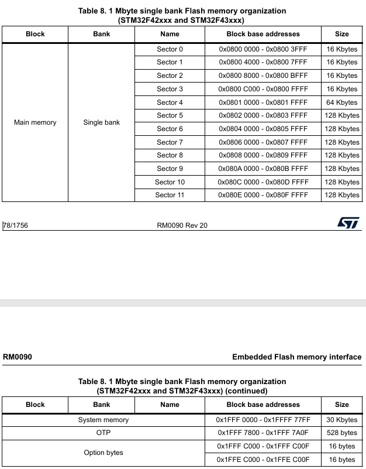
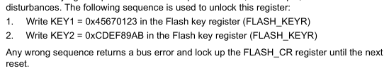
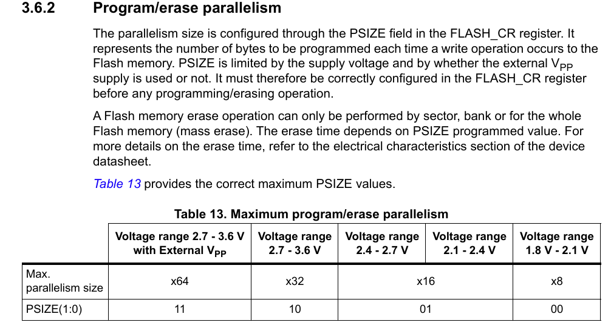

# 常用存储器介绍和访问操作

存储器是嵌入式系统中用于存放程序、数据的部件；根据断电数据是否保留易失性存储器和非易失性存储器两大类。

对于易失性存储器，典型的有SRAM、PSARM、SDRAM、DDRx等，而非易失性存储器则包括ROM、FLASH、EPPROM、SDCard。

本节中将详细介绍存储器，以及STM32内部FLASH的操作方法，具体目录如下所示。

📑 **常用存储器介绍**  
📑 **内部FLASH的访问读写**  
📑 **总结说明**

本节配合例程如下所示。

📀 FLASH应用例程： **code/01-14_STM32F429_FLASH/**。

## 常用存储器介绍

### 易失性存储器介绍

RAM是`Random Access Memory`的缩写，被译为随机存储器。所谓“随机存取”，指的是当存储器中的消息被读取或写入时，所需要的时间与这段信息所在的位置无关。

| 类型英文全称 | 二级分类 | 工作原理 | 是否需要刷新 | 典型应用 |
| --- | --- | --- | --- | --- |
| Static RAM (SRAM) | SRAM | 利用触发器保存数据 | 否 | MCU 内部 RAM、CPU Cache |
| Dynamic RAM (DRAM) | DRAM | 利用电容存储电荷 | 是 | 计算机内存、嵌入式外部 RAM |
| Asynchronous SRAM (Async SRAM) | SRAM | 不依赖同步时钟，使用地址及控制信号访问 | 否 | 外部并行存储器、工业设备 |
| Synchronous DRAM (SDRAM) | DRAM | DRAM 同步接口，按时钟进行命令与数据传输 | 是 | 早期计算机内存、嵌入式外部内存 |
| Double Data Rate SDRAM (DDR SDRAM) | DRAM | 双倍数据速率同步 DRAM，在时钟上升沿和下降沿传输数据 | 是 | PC 内存、嵌入式高速内存 |
| Pseudo SRAM (PSRAM) | DRAM | 通常采用 DRAM 存储单元，并集成刷新控制逻辑，提供类似 SRAM 的访问方式 | 通常需要内部刷新，由芯片内部处理 | MCU 外部扩展 RAM、图形缓存、视频缓冲区 |

DRAM相对于SRAM来说，速度较慢，但是成本相对低廉；适合应用于需要大量存储的场景，如GUI显示、图形缓冲等。

PSRAM则是支持自刷新，从而可以使用其它接口方式访问的DRAM，具有占用接口少，使用方式简单的特点，但是速度相对于DRAM也更慢。

在单片机开发中，对于频繁使用的任务堆栈、全局变量一般使用内部SRAM，提供执行效率；对于需要占用大量空间的缓存，如GUI缓冲去、视频流缓冲区等，则使用外部的DRAM或PSRAM区域。

### 非易失性存储器介绍

非易失性存储器（Non-Volatile Memory，NVM）是指断电后仍能保留所存储数据的存储器，常用于程序代码、配置参数、运行日志及长期数据保存。

典型的非易失性存储器包含ROM、FLASH等，具体列表如下所示。

| 类型英文全称 | 二级分类 | 工作原理 | 主要特点 | 典型应用 |
| --- | --- | --- | --- | --- |
| Read-Only Memory | ROM | 通过制造工艺固化数据 | 通常不可由用户修改 | 固化程序、固定查找表 |
| Programmable ROM | PROM | 通过编程永久写入数据 | 通常只能编程一次 | 固定配置、早期嵌入式设备 |
| Erasable Programmable ROM | EPROM | 通过电编程写入，使用紫外线擦除 | 擦除不便，需要专用设备 | 早期单片机程序存储 |
| Electrically Erasable Programmable ROM | EEPROM | 通过电信号擦除和写入数据 | 可按字节或较小单元更新，具体取决于器件 | 参数保存、校准数据 |
| Flash Memory | Flash | 通过电荷存储机制保存数据，按块或扇区擦除 | 容量大、成本较低，擦除粒度较大 | MCU 程序、固态硬盘、存储卡 |
| NOR Flash Memory | NOR Flash | NOR 型闪存阵列结构 | 支持随机读取，适合代码直接执行（XIP） | MCU 外部程序存储、固件 |
| NAND Flash Memory | NAND Flash | NAND 型闪存阵列结构 | 高存储密度，适合大容量数据 | SSD、eMMC、UFS、SD 卡 |
| Ferroelectric RAM | FRAM | 利用铁电材料的极化状态保存数据 | 写入快、耐久性高、低功耗，具体指标依型号而定 | 高频参数记录、计量设备 |
| Magnetoresistive RAM | MRAM | 利用磁性状态保存数据 | 高耐久性、速度较快，可用于嵌入式非易失存储 | 工业设备、汽车电子 |
| Resistive RAM | ReRAM | 利用材料电阻状态变化保存数据 | 有高密度、低功耗潜力 | 新型存储器、研究与专用芯片 |
| Phase-Change Memory | PCM | 利用材料不同相态的电阻差异保存数据 | 兼具非易失性与电阻式存储特征 | 专用存储与研究领域 |

对于STM来说，其内部FLASH就属于Flash Memory，支持程序和数据存储，以及代码执行。

日常使用的SPI FLASH，则属于NAND Flash类型，而NOR FLASH一般使用QSPI访问，可以通过XIP方式执行代码。

## 内部FLASH的访问读写

对于STM32来说，内部FLASH的数据操作简单、读写方便的特点，相比外挂器件使用更方便。另外，如果成品中禁止调试，存储在内部FLASH的数据也更安全。

### 内部FLASH分区说明

以STM32F429为例，对应的FLASH分区如下所示。



根据上述分区所示，整个FLASH由主存储区、系统存储区、OTP区域和选项字节区域组成，具体功能分别如下所示。

💡 **主存储区（main memory）:** 主存储区范围为`0x08000000 ~ 0x080FFFFF`，有12个块，其中4个16KB、1个64KB和7个128KB的块，总共1024KB，即1MB的存储容量。执行代码和数据存储一般都使用主存储区存储，可通过一定时序和指令时序读写操作，是我们日常使用最多的区域  
💡 **系统存储区（system memory）:** 系统存储区范围为`0x1FFF0000 ~ 0x1FFF7FFF`，这部分是STM32F4在芯片生产时固化的程序存储的区域，主要做DFU功能支持(如串口、USB下载等)，用户无法访问此区域  
💡 **OTP区域（one time programmable memory）:** OTP区域范围为`0x1FFF7800 ~ 0x1FFF7A0F`，这个是一次性可编程区域，共528字节，其中前面512字节可以用来存储一次性的用户数据，后面16字节用于锁定对应块。OTP区域写入后不支持擦除，可以用来限制软件版本、签名标志等安全相关的数据存储，不过是一次性的，因此不理解时不要去尝试  
💡 **选项字节区域（option bytes）:** 选项字节区域范围为`0x1FFFC000 ~ 0x1FFFC000F、0x1FFEC000 ~ 0x1FFEC00F`，这个区域主要预留一些寄存器用来配置FLASH的读写保护、待机/停机、软件/硬件看门狗功能，和主存储区一样，可以通过一定时序和指令进行读写操作  

对于上述FLASH区域，日常主要操作的就是主存储区，包括代码和配置参数的存储都是在此区域处理。

对于FLASH来说，还有一个特性影响执行正确率和读取效率，就是FLASH读访问延时。内核的执行很快，而FLASH的读访问速度相对较慢，这就导致了在读取数据时可能会出现数据不一致的情况。

为了解决这个问题，需要根据具体的工作电压和HCLK时钟频率来确定FLASH的读取延时，这个需要根据具体的工作电压和HCLK时钟频率来确定。使用STM32CubexMX生成代码时会根据时钟计算，例如180MHz的HCLK，工作电压为3.3V，对应的就是5个时钟的延迟。具体代码如下所示。

```c
//AHBCLK    = SYSCLK    =180Mhz
//APB1CLK   = AHBCLK/4  =45M 
//APB1TIME  = APB1CLK*2 =90M 
//APB2CLK   = AHBCLK/2  =90M
//APB2TIME  =APB2*2     =180M   
RCC_ClkInitStruct.ClockType = RCC_CLOCKTYPE_HCLK|RCC_CLOCKTYPE_SYSCLK
                        |RCC_CLOCKTYPE_PCLK1|RCC_CLOCKTYPE_PCLK2;
RCC_ClkInitStruct.SYSCLKSource = RCC_SYSCLKSOURCE_PLLCLK;
RCC_ClkInitStruct.AHBCLKDivider = RCC_SYSCLK_DIV1;
RCC_ClkInitStruct.APB1CLKDivider = RCC_HCLK_DIV4;
RCC_ClkInitStruct.APB2CLKDivider = RCC_HCLK_DIV2;

// FLASH读取延时
if (HAL_RCC_ClockConfig(&RCC_ClkInitStruct, FLASH_LATENCY_5) != HAL_OK)
{
    return RT_FAIL;
}
```

### FLASH读取数据

对于FLASH的读操作，已经被映射到内部的存储空间，用户可以像访问内存一样访问，不需要额外的处理。另外配合结构体和指针，可以轻松提取出FLASH中数据，具体代码如下所示。

```c
// 从FLASH中读取数据
// 读取直接按照字节读，比较简单
FlashType_t flash_read(uint32_t address, uint8_t *pbuffer, uint32_t size)
{
    uint16_t index;
    
    for(index=0; index<size; index++) 
    {
        pbuffer[index] = *((uint8_t *)(address+index));
    }
    return FLASH_OK;    
}

// 按照字读取，这里长度需要按照int型转换后的个数
FlashType_t flash_read_word(uint32_t address, uint32_t *pbuffer, uint32_t size)
{
    uint16_t index;
    
    for(index=0; index<size; index++) 
    {
        pbuffer[index] = *((uint32_t *)(address+index));
    }
    return FLASH_OK;    
}

// 从0x08000000地址读取64字节数据到buf中
uint8_t buf[64];
flash_read(0x08010000, buf, 64);

// 读取数据结构体
__packed struct data_t
{
    uint32_t id;
    uint8_t name[16];
    uint8_t age;
    uint8_t reserved[30];
};
struct data_t *pdata = (struct data_t *)0x08010000;
uint32_t id = pdata->id;    // 读取id字段
uint8_t age = pdata->age;  // 读取age字段
```

可以看到，对于内部FLASH的读取操作，可以采用直接访问内存的方式，也可以采用结构体和指针的方式提取数据；不过需要注意的是，在存储结构体数据时要考虑数据对齐的问题，才能够保证实际数据和预期一致。

### FLASH写入数据

对于单片机来说，FLASH的操作和对于外部SPI FLASH的操作类似，也是需要先擦除后写入，不过在此基础上要增加解锁和后续的锁定动作，这部分可参考说明如下。



可以看到，先后向FLASH_KEYR寄存器写入解锁值0x45670123，再写入解锁值0xCDEF89AB，即可完成解锁。

之后，就可以执行擦除和写入的动作，并在结束后锁定FLASH操作。

这部分由HAL库实现，具体代码如下所示。

```c
// 从地址获取对应的sector
uint16_t flash_get_sector(uint32_t address)
{
    if (address < FLASH_SECTOR1_ADDRESS) {
        return FLASH_SECTOR_0; 
    } else if (address < FLASH_SECTOR2_ADDRESS) {
        return FLASH_SECTOR_1;
    } else if (address < FLASH_SECTOR3_ADDRESS) {
        return FLASH_SECTOR_2;
    } else if (address < FLASH_SECTOR4_ADDRESS) {
        return FLASH_SECTOR_3;
    } else if (address < FLASH_SECTOR5_ADDRESS) {
        return FLASH_SECTOR_4;
    } else if (address < FLASH_SECTOR6_ADDRESS) {
        return FLASH_SECTOR_5;
    } else if (address < FLASH_SECTOR7_ADDRESS) {
        return FLASH_SECTOR_6;
    } else if (address < FLASH_SECTOR8_ADDRESS) {
        return FLASH_SECTOR_7;
    } else if (address < FLASH_SECTOR9_ADDRESS) {
        return FLASH_SECTOR_8;
    } else if (address < FLASH_SECTOR10_ADDRESS) {
        return FLASH_SECTOR_9;
    } else if (address < FLASH_SECTOR11_ADDRESS) {
        return FLASH_SECTOR_10;
    } else {
        return FLASH_SECTOR_11;
    }
}

// 根据sector擦除指定扇区
FlashType_t flash_erase_device(uint32_t sector, uint32_t nb_sectors)
{
    FLASH_EraseInitTypeDef FlashEraseInit = {0};
    uint32_t sector_error;
    
    HAL_FLASH_Unlock(); 

    //erase page0
    FlashEraseInit.TypeErase = FLASH_TYPEERASE_SECTORS;     // 按SECTORS擦除
    FlashEraseInit.Banks = FLASH_BANK_1;                    // 擦除BANK1区域，此型号只有BANK_1
    FlashEraseInit.Sector = sector;                         // 擦除的起始扇区
    FlashEraseInit.NbSectors = nb_sectors;                  // 擦除的扇区数
    FlashEraseInit.VoltageRange = FLASH_VOLTAGE_RANGE_3;    // 擦除时FLASH工作电压范围
    
    if(HAL_FLASHEx_Erase(&FlashEraseInit, &sector_error) != HAL_OK)  
    {
        HAL_FLASH_Lock(); 
        return FLASH_ERROR;
    }

    HAL_FLASH_Lock(); 
    return FLASH_OK;
}

// 写FLASH设备，按字写入
FlashType_t flash_write_word(uint32_t address, uint32_t *pbuffer, uint32_t size)
{
    uint32_t index;
    
    // 写入地址必须是4字节对齐
    if (address % 4 != 0) {
        return FLASH_ERROR;
    }

    // 如果写入地址或大小不是4字节对齐，有两种处理方式
    // 1. 直接返回错误，此时比较简单(提前暴露问题，不然后续会发生就会多写或者少写，有隐患)
    // 2. 申请4字节对齐的内存，将数据复制进去，写入后释放内存
    if (((uint32_t)pbuffer)%4 != 0) {
        return FLASH_ERROR;
    }

    HAL_FLASH_Unlock();       
    for(index=0; index<size; index++)
    {
        if(HAL_FLASH_Program(FLASH_TYPEPROGRAM_WORD, address+index*4, pbuffer[index]) != HAL_OK)
        {
            HAL_FLASH_Lock();
            return FLASH_ERROR;
        }
    } 
    HAL_FLASH_Lock();
    return FLASH_OK;
}

// 写FLASH设备，按字节写入，不需要考虑对齐和长度问题，不过效率较低
FlashType_t flash_write(uint32_t address, uint8_t *pbuffer, uint32_t size)
{
    uint32_t index;

    HAL_FLASH_Unlock();       
    for(index=0; index<size; index++)
    {
        if(HAL_FLASH_Program(FLASH_TYPEPROGRAM_BYTE, address+index, pbuffer[index]) != HAL_OK)
        {
            HAL_FLASH_Lock();
            return FLASH_ERROR;
        }
    } 
    HAL_FLASH_Lock();
    
    return FLASH_OK;
}
```

擦除代码就是指定擦除块、起始扇区、扇区长度即可完成擦除；不过这里面有个知识点并没有说明，就是擦除时FLASH工作电压范围，对于STM32F4来说，不同工作电压对应擦除时不同的并行位数，也就影响着擦除时间。

对于FLASH的擦除来说，并行位数和工作电压关系如下所示。



这里设定的FLASH_VOLTAGE_RANGE_3表示工作电压为2.7~3.6V，对应擦除时并行位数为32位。

## 总结说明

本节中，主要讲解FLASH的功能，包括分区结构，擦除、读取和写入操作，并封装成相应的接口进行测试处理。

FLASH作为存储设备，主要用于存储程序代码和数据，读取时和其他内部存储一致；写入时则需要擦除的指令时序才能正常执行，完成数据处理流程。

作为单片机内部的存储空间，FLASH操作在配置管理、在线升级方面都是核心功能，需要在开发前掌握。

## 返回目录

[返回目录](./../README.md)
