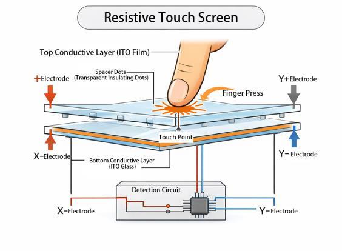
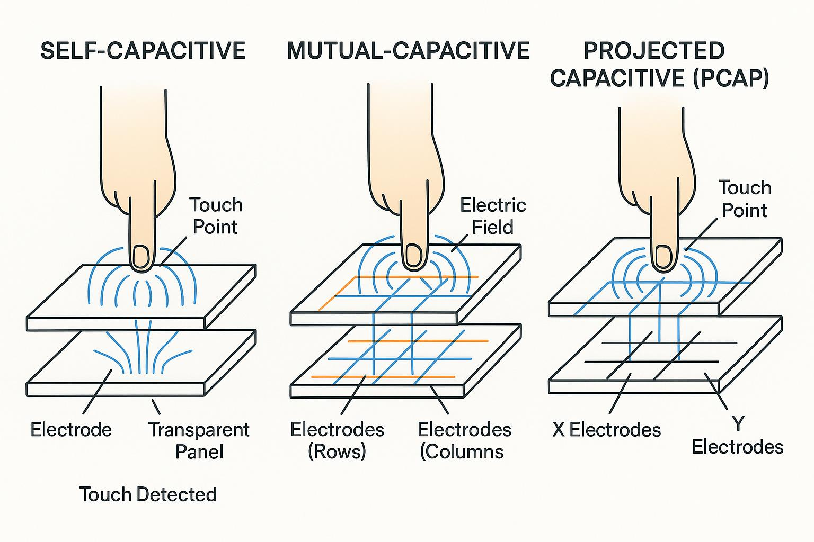
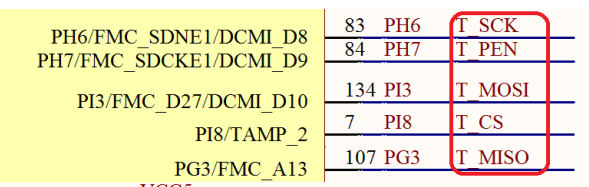

# 触摸屏交互处理

在嵌入式设备、工业控制面板、医疗设备和 LVGL 图形界面中，触摸功能并不只是“检测手指是否按下”，而是包含触摸感知、坐标获取、触摸状态跟踪、手势处理、事件分发以及与 GUI框架的集成。

在应用中，触摸屏技术决定如何感知触摸，例如电容式或电阻式；触摸输入软件负责把硬件数据转换成应用程序能理解的触摸事件。

本节目录如下所示。

📑 **触摸屏工作原理**  
📑 **触摸屏的应用**  
📑 **总结说明**  

## 触摸屏工作原理

对于常见的触摸屏技术，主要分为电阻式/电容式。

🧩 **电阻式触摸屏**

主要通过导电膜受到压力后，发生接触产生电压变化，通过检测电压即可确定按压点。

典型的四线电阻式触摸屏包含两层透明导电膜：

- 上层：柔性导电层
- 下层：固定导电层
- 中间：绝缘间隔点，防止未触摸时两层直接接触
- 表面：保护层，承受手指或触控笔的压力



手指按压时，上层发生轻微形变，与下层在触摸位置接触。控制器通过测量导电层上的电压，计算触摸点的坐标。

电阻式触摸屏可以理解为一个位置可变的电位器。例如，在X方向的导电层两端施加电压，形成从左到右的电压梯度。触摸点接触另一层后，测量接触点电压，就可以换算出X坐标。
随后切换电极的驱动方式，在Y方向建立电压梯度，测得Y坐标。

对于四线电阻式触摸屏，测量过程大致如下：

1. 对X电极施加电压梯度。
2. 读取触摸点电压，计算X坐标。
3. 切换到Y方向施加电压梯度。
4. 读取触摸点电压，计算Y坐标。
5. 重复采样，对坐标进行滤波。
6. 根据触摸压力、采样结果或控制器状态判断是否存在有效触摸。

需要注意，四线电阻式触摸一般采用交替测量 X、Y 坐标的方式，并非直接同时得到两个坐标。

🧩 **电容式触摸屏**

电容式触摸屏利用人体手指与触摸电极之间的电场耦合来检测触摸。最常见的屏幕方案是投射电容式触摸（Projected Capacitive，PCAP）。

其基本结构包含透明导电电极、绝缘层和触摸控制器。电极通常形成横向和纵向的感应网格。

当手指靠近或接触屏幕时，局部电场和电极的等效电容会发生变化。触摸控制器测量这些变化，计算出触摸位置。



实际电路中，电容变化可能通过自电容或互电容方式测量。

💡 自电容式测量，只测单条电极对地的电容 Cx，不需要TX/RX配对
💡 互电容式测试，测量TX和RX之间的耦合电容有没有被手指影响电场

现代多点触摸屏普遍使用互电容感测技术，因为它更适合区分多个触摸点。

## 触摸屏的应用

对于本例中使用的GT9147属于电容式触摸屏，通过持续的扫描触摸电容，计算出x坐标、y坐标、触摸点数量、触摸点ID等信息，用于后续访问控制。

### 硬件连接接口

关于触摸相关的接口，如下所示。

| MCU信号 | GT9147信号 | I/O特性 | 说明 |
| --- | --- | --- | --- |
| I2C_SCL | SCL | Output | IIC时钟信号 |
| I2C_SDA | SDA | Bidirectional | IIC数据信号 |
| TP_INT | INT | Input | 触摸中断信号 |
| TP_RST | RST | Output | GT9147硬件复位信号 |

具体硬件连接如下所示。



### 驱动实现方法

对于触摸屏来说，驱动的实现步骤如下所示。

🛠️ 初始化相关的工作引脚，配置为i2c、中断接收、gpio等
🛠️ 配置gt9147，适配当前的屏幕信息
🛠️ 提供检测触摸信号和触摸点读取的接口

具体实现如下所示。

🧩 初始化硬件接口

```c
__HAL_RCC_GPIOH_CLK_ENABLE();
__HAL_RCC_GPIOI_CLK_ENABLE();

/* RST is a push-pull output; INT is an input - during the reset pulse the
    * chip samples it to pick its slave address, so it must never be driven. */
GPIO_InitStruct.Mode      = GPIO_MODE_OUTPUT_PP;
GPIO_InitStruct.Pull      = GPIO_PULLUP;
GPIO_InitStruct.Speed     = GPIO_SPEED_FREQ_HIGH;
GPIO_InitStruct.Alternate = 0U;
GPIO_InitStruct.Pin       = GT_RST_PIN;
HAL_GPIO_Init(GT_RST_PORT, &GPIO_InitStruct);

GPIO_InitStruct.Mode = GPIO_MODE_INPUT;
GPIO_InitStruct.Pull = GPIO_PULLUP;
GPIO_InitStruct.Pin  = GT_INT_PIN;
HAL_GPIO_Init(GT_INT_PORT, &GPIO_InitStruct);

// soft i2c init
bsp_sw_i2c_init();

/* ---- reset pulse ---------------------------------------------------- */
HAL_GPIO_WritePin(GT_RST_PORT, GT_RST_PIN, GPIO_PIN_RESET);
bsp_delay_ms(10U);
HAL_GPIO_WritePin(GT_RST_PORT, GT_RST_PIN, GPIO_PIN_SET);
bsp_delay_ms(10U);
```

🧩 初始化gt9147硬件，适配硬件信息

```c
// gt9147的硬件配置表
static const uint8_t GT_CFG_TBL[GT_CFG_LEN] =
{
    0x60, 0xE0, 0x01, 0x20, 0x03, 0x05, 0x35, 0x00, 0x02, 0x08,
    0x1E, 0x08, 0x50, 0x3C, 0x0F, 0x05, 0x00, 0x00, 0xFF, 0x67,
    0x50, 0x00, 0x00, 0x18, 0x1A, 0x1E, 0x14, 0x89, 0x28, 0x0A,
    0x30, 0x2E, 0xBB, 0x0A, 0x03, 0x00, 0x00, 0x02, 0x33, 0x1D,
    0x00, 0x00, 0x00, 0x00, 0x00, 0x00, 0x00, 0x32, 0x00, 0x00,
    0x2A, 0x1C, 0x5A, 0x94, 0xC5, 0x02, 0x07, 0x00, 0x00, 0x00,
    0xB5, 0x1F, 0x00, 0x90, 0x28, 0x00, 0x77, 0x32, 0x00, 0x62,
    0x3F, 0x00, 0x52, 0x50, 0x00, 0x52, 0x00, 0x00, 0x00, 0x00,
    0x00, 0x00, 0x00, 0x00, 0x00, 0x00, 0x00, 0x00, 0x00, 0x00,
    0x00, 0x00, 0x00, 0x00, 0x00, 0x00, 0x00, 0x00, 0x00, 0x0F,
    0x0F, 0x03, 0x06, 0x10, 0x42, 0xF8, 0x0F, 0x14, 0x00, 0x00,
    0x00, 0x00, 0x1A, 0x18, 0x16, 0x14, 0x12, 0x10, 0x0E, 0x0C,
    0x0A, 0x08, 0x00, 0x00, 0x00, 0x00, 0x00, 0x00, 0x00, 0x00,
    0x00, 0x00, 0x00, 0x00, 0x00, 0x00, 0x00, 0x00, 0x00, 0x00,
    0x00, 0x00, 0x29, 0x28, 0x24, 0x22, 0x20, 0x1F, 0x1E, 0x1D,
    0x0E, 0x0C, 0x0A, 0x08, 0x06, 0x05, 0x04, 0x02, 0x00, 0xFF,
    0x00, 0x00, 0x00, 0x00, 0x00, 0x00, 0x00, 0x00, 0x00, 0x00,
    0x00, 0xFF, 0xFF, 0xFF, 0xFF, 0xFF, 0xFF, 0xFF, 0xFF, 0xFF,
    0xFF, 0xFF, 0xFF, 0xFF,
};

static int gt_send_cfg(int save)
{
    uint8_t buf[2];
    uint32_t sum = 0U;
    uint16_t i;

    for (i = 0U; i < GT_CFG_LEN; i++)
    {
        sum += GT_CFG_TBL[i];
    }
    buf[0] = (uint8_t)((~sum) + 1U);        /* two's complement checksum */
    buf[1] = (uint8_t)(save ? 1U : 0U);     /* 1 = write to flash        */

    if (gt_write(GT_CFGS_REG, GT_CFG_TBL, GT_CFG_LEN) != 0) { return -1; }
    if (gt_write(GT_CHECK_REG, buf, 2U) != 0)               { return -1; }

    return 0;
}

int bsp_gt9147_init(void)
{
    //...
    
        /* ---- find the chip and read its product ID -------------------------- */
    for (i = 0; i < 2; i++)
    {
        s_addr = addr_candidates[i];
        (void)memset(id, 0, sizeof(id));
        if (gt_read(GT_PID_REG, id, GT9147_ID_LEN) == 0)
        {
            break;
        }
        s_addr = 0U;
    }

    (void)memcpy(s_id, id, GT9147_ID_LEN);
    s_id[GT9147_ID_LEN] = '\0';

    if (s_addr == 0U)
    {
        PRINT_LOG("[TOUCH] GT9147 not found on 0x%02X / 0x%02X (check T_SCK/T_MOSI wiring)\r\n",
               (unsigned int)GT_ADDR_LO, (unsigned int)GT_ADDR_HI);
        return -1;
    }

    /* ---- verify the product ID ------------------------------------------ */
    {
        int known = (strcmp(s_id, "9147") == 0) ||
                    (strcmp(s_id, "911")  == 0) ||
                    (strcmp(s_id, "1158") == 0) ||
                    (strcmp(s_id, "9271") == 0) ||
                    (strcmp(s_id, "928")  == 0);

        PRINT_LOG("[TOUCH] product ID = \"%s\" (addr 0x%02X) -> %s\r\n",
               s_id, (unsigned int)s_addr, known ? "MATCH" : "MISMATCH");

        if (!known)
        {
            PRINT_LOG("[TOUCH] expected one of 911 / 9147 / 1158 / 9271 / 928\r\n");
            return -2;
        }
    }

    /* ---- report what the chip is configured for ------------------------ *
     * Read on every supported part, not just the 9147: the resolution is
     * what the raw coordinates are expressed in, so the caller needs it to
     * map a touch onto the display.  (Only the 9147 gets the configuration
     * block below uploaded - the block is 9147 specific.) */
    {
        uint8_t cfg[5];

        if (gt_read(GT_CFGS_REG, cfg, sizeof(cfg)) == 0)
        {
            s_ver     = cfg[0];
            s_panel_x = (uint16_t)(((uint16_t)cfg[2] << 8) | cfg[1]);
            s_panel_y = (uint16_t)(((uint16_t)cfg[4] << 8) | cfg[3]);
        }
        PRINT_LOG("[TOUCH] stored config: version=0x%02X resolution=%ux%u\r\n",
               (unsigned int)s_ver, (unsigned int)s_panel_x, (unsigned int)s_panel_y);
    }

    /* ---- GT9147: refresh the configuration if it is out of date --------- */
    if (strcmp(s_id, "9147") == 0)
    {
        /* soft reset: hold the chip in reset while the block is uploaded */
        tmp = 0x02U;
        if (gt_write(GT_CTRL_REG, &tmp, 1U) != 0)
        {
            PRINT_LOG("[TOUCH] soft reset write FAILED\r\n");
            return -2;
        }

        if (s_ver < GT_CFG_VERSION)
        {
            if (gt_send_cfg(1) != 0)
            {
                PRINT_LOG("[TOUCH] config upload FAILED\r\n");
            }
            else
            {
                PRINT_LOG("[TOUCH] config updated (%u bytes, %ux%u) and saved\r\n",
                       (unsigned int)GT_CFG_LEN,
                       (unsigned int)GT9147_PANEL_X, (unsigned int)GT9147_PANEL_Y);
                s_ver     = GT_CFG_VERSION;
                s_panel_x = GT9147_PANEL_X;
                s_panel_y = GT9147_PANEL_Y;
            }
        }
        else
        {
            PRINT_LOG("[TOUCH] config already up to date, kept as is\r\n");
        }

        /* release the soft reset */
        tmp = 0x00U;
        (void)gt_write(GT_CTRL_REG, &tmp, 1U);
        bsp_delay_ms(10U);
    }
}
```

可以看到，这里先读取GT9147的ID，进行判断确认后，写入适配硬件的配置文件GT_CFG_TBL，然后更新释放芯片，此时gt9147就能够正常工作。

🧩 获取触摸点信息

对于触摸点信息获取，先获取触摸点的数目，在根据数目读取触摸点地址，具体实现如下所示。

```c
int bsp_gt9147_read(gt9147_point_t *points, uint8_t max)
{
    uint8_t status = 0U;
    uint8_t count;
    uint8_t buf[4];
    uint8_t i;
    uint8_t zero = 0U;

    if ((s_ready == 0U) || (points == NULL) || (max == 0U))
    {
        return -1;
    }

    if (gt_read(GT_GSTID_REG, &status, 1U) != 0)
    {
        return -1;
    }

    count = (uint8_t)(status & 0x0FU);
    if (count > GT9147_MAX_POINTS)
    {
        count = GT9147_MAX_POINTS;
    }
    if (count > max)
    {
        count = max;
    }

    if (count != 0U)
    {
        for (i = 0U; i < count; i++)
        {
            if (gt_read((uint16_t)(GT_TP1_REG + (i * GT_TP_STRIDE)), buf, 4U) != 0)
            {
                break;
            }
            points[i].x = (uint16_t)(((uint16_t)buf[1] << 8) | buf[0]);
            points[i].y = (uint16_t)(((uint16_t)buf[3] << 8) | buf[2]);
        }
        count = i;
    }

    /* Clear the status register: the chip only raises the next interrupt once
     * this has been written back to 0. */
    (void)gt_write(GT_GSTID_REG, &zero, 1U);

    return (int)count;
}
```

之后将触摸点读取信息在应用中读取进行转换后再系统中即可使用。

## 总结说明

GT9147是一款常用于电容式触摸屏的多点触摸控制器，通常通过 I²C 接口与 MCU 通信，并通过 INT 引脚通知主控触摸数据更新。其内部完成电容扫描、触点识别及坐标计算，MCU 无须直接测量电容变化。

开发时需要重点关注I²C通信错误、复位与中断时序、触摸数据有效性、屏幕旋转及X/Y轴映射，以及触摸释放状态的正确处理。

不过对于产品来说，触摸屏本身也只是输入的一部分，需要转换后通知到UI等应用，最终才能构建可用的功能。

## 返回目录

[返回目录](./../README.md)
