# Threadx的移植和应用

ThreadX，现命名为Eclipse ThreadX；它由Express Logic公司开发，后由微软收购并开源，目前移交给Eclipse Foundation管理。是嵌入式领域里使用广泛的实时操作系统。

对于ThreadX来说，具有高性能、极小内存占用以及高度可靠性的特性，使其广泛运用于医疗设备、工业控制、智能设备等领域。

关于Threadx，本节的目录如下所示。

📑 **ThreadX的下载、移植和任务创建**  
📑 **配置功能选项**  
📑 **任务管理和线程同步方法**  
📑 **总结说明**  

## ThreadX的下载、移植和任务创建

对于ThreadX来说，和FreeRTOS类似，同样也包含从官方仓库下载或使用STM32CubeMX工具生成两种方案。

本小节将以STM32H743芯片为例，对于两种方式分别进行介绍。

### 从ThreadX官方下载和移植

对于ThreadX应用，官方托管在Github中，具体下载网址如下所示。

- [ThreadX下载](https://github.com/eclipse-threadx/threadx)

移植ThreadX，需要将ThreadX的源代码拷贝到相应的目录下，并添加到项目中，同时添加芯片的支持。

关于ThreadX的移植，需要添加到MDK工程的文档如下图标注所示。

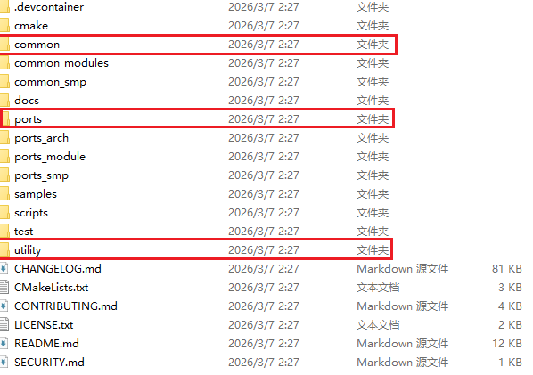

关于目录和功能说明如下所示。

| 文件夹名称 | 功能说明 |
| --- | --- |
| common | 存放ThreadX的公共文件，包含线程、任务、信号量、互斥锁等公共文件。 |
| ports | 芯片平台相关的文件，以ARM核的不同进行分类，这里以ARM Cortex-M7为例。 |
| untility | 存放ThreadX的辅助组件，如低功耗、benchmark等。 |

另外，为了支持ThreadX的应用，还需要参考ports/[chip]/[tools]/example_build下的工程文件实现移植代码，构建后的项目格式如下所示。

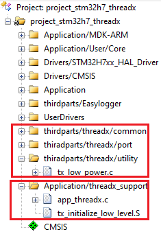

其中`thirdparts/threadx/**`为ThreadX的源代码目录中的对应文件，`Appplication/threadx_support/**`则为ThreadX则为移植支持运行的代码。

其中tx_initialize_low_level.S中主要定义了系统启动、OS滴答时钟配置的实现，可以直接使用上述example_build中的代码，不过要注意以下两个配置，会影响到系统的时钟ticks，从而影响所有延时等待的应用。

| 配置项 | 说明 |
| --- | --- |
| SYSTEM_CLOCK | 系统时钟频率，单位为MHz，需要和实际MCU使用的时钟频率一致。 |
| SYSTICK_CYCLES | RTOS的滴答频率，需要根据系统时钟和RTOS的期望周期来计算。 |

对于app_threadx.c中的代码，主要实现tx_application_define()函数。在使用静态内存池的场景下，需要在此处分配并配置静态内存池以及创建应用线程。

```c
static UINT app_threadx_init(VOID *memory_ptr);
static void tx_app_thread_idle(ULONG thread_input);
 
VOID tx_application_define(VOID *first_unused_memory)
{
#if (USE_STATIC_ALLOCATION == 1)
    UINT status = TX_SUCCESS;
    VOID *memory_ptr;

    if (tx_byte_pool_create(&tx_app_byte_pool, "Tx App memory pool", tx_byte_pool_buffer, TX_APP_MEM_POOL_SIZE) != TX_SUCCESS)
    {
      return;
    }

    memory_ptr = (VOID *)&tx_app_byte_pool;
    
    // threadx init
    app_threadx_init(memory_ptr);

    // application init
    application_init(memory_ptr);
#else
  (void)first_unused_memory;
#endif
}

UINT app_threadx_init(VOID *memory_ptr)
{
    UINT ret = TX_SUCCESS;
    TX_BYTE_POOL *byte_pool = (TX_BYTE_POOL*)memory_ptr;

    CHAR *pointer;

    if (tx_byte_allocate(byte_pool, (VOID**) &pointer,
                       TX_APP_STACK_SIZE, TX_NO_WAIT) != TX_SUCCESS)
    {
        return TX_POOL_ERROR;
    }

    if (tx_thread_create(&tx_app_thread, "tx app thread", tx_app_thread_idle, 0, pointer,
                       TX_APP_STACK_SIZE, TX_APP_THREAD_PRIO, TX_APP_THREAD_PREEMPTION_THRESHOLD,
                       TX_APP_THREAD_TIME_SLICE, TX_APP_THREAD_AUTO_START) != TX_SUCCESS)
    {
        return TX_THREAD_ERROR;
    }

    return ret;
}
```

此时，在main函数中调用tx_kernel_enter()即可启动系统。

当然，移植到STM32CubeMX工程生成的项目，需要有以下注意点。

1. 将HAL库时钟修改为非SysTick时钟(被OS占用)，同时优先级修改为高于OS管理的优先级，一般都为0即可
2. 默认不生成SysTick和Pensv中断，这部分也是在OS进行初始化和实现

使用官方下载的方案，优点是可以随时更新替换最新的代码，不用担心STM32CubeMX生成时带来的兼容性问题，完全由自己掌控。

### 使用STM32CubeMX生成工程

对于STM32CubeMX生成工程，则移植和实现更加简单，只需要通过图形生成即可。

- 准备工作

准备工作主要包含两部分工作。

1. 修改系统时钟和不生成SysTick和Pensv中断，这部分可参考之前FreeRTOS的移植说明。
2. 更新STM32CubeMX支持ThreadX的应用

对于STM32CubeMX来说，默认下载可能不支持ThreadX应用，需要先安装，具体步骤如下所示。

1. 选择`Middleware and Software Packs`，查看是否有`X-CUBE-AZRTOS-H7`，不存在可以点击任何选项下任意一个未加载的软件，弹出管理界面。
2. 在管理界面中找到`STMicroelectronics.X-CUBE-AZRTOS-H7`，点击`Install`进行安装。

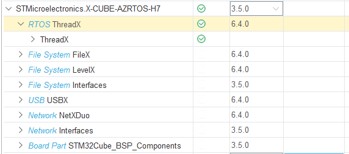

安装成功后，选项下会出现`X-CUBE-AZRTOS-H7`应用，如下所示。

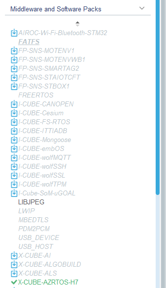

- 创建工程

勾选`X-CUBE-AZRTOS-H7`中的`RTOS ThreadX`选项，并进行配置，此步骤会同步生成起始任务并存放于app_threadx.c文件中。

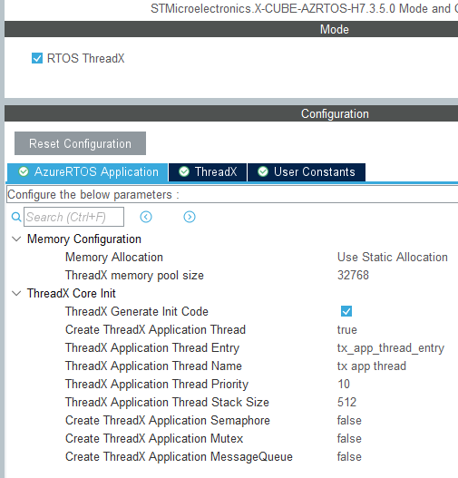

用户在`tx_app_thread_entry()`函数中即可添加应用，如LED闪烁、串口打印等，即完成了基础的Threadx系统移植。另外在ThreadX选项中提供了系统功能的配置选项，包括最小堆栈允许值、定时器管理、性能分析等。

之后在app_threadx_init中添加应用初始化代码，`tx_app_thread_entry()`函数中即可添加应用，如LED闪烁、串口打印等，即完成了基础的Threadx系统移植。

```c
// app_threadx.c
// led blink task
void tx_app_thread_entry(ULONG thread_input)
{
    while(1)
    {
        LED_ON;

        tx_thread_sleep(1000);

        LED_OFF;

        tx_thread_sleep(1000);
    }
}
```

可以看到STM32CubeMX生成的工程的方法相对来说更简单快捷，可以做到开箱即用。不过这也隐藏了移植和适配的过程，如需要更换版本，就需要自行适配调整。

## Queue消息队列

对于threadx来说，队列是用于在线程之间传递固定大小数据的数据结构。

队列（Queue）是先进先出的数据结构，在初始化创建指定长度和大小的缓冲区。对于队列来说，每个元素都是固定大小的，这样在后续的读写中，按照相同的数据格式进行读写即可。

对于threadx来说，队列中传递的数据可以是基础类型、结构体、联合体数据和指针等。其中传递指针时，需要确保原数据在目的线程使用前是有效的，这样可以在提供性能的情况下避免数据无效的问题。

### threadx队列特点和原理

对于队列的处理，其工作原理如下所示。

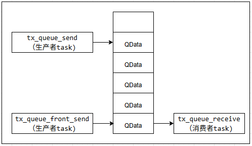

生成者主要通过tx_queue_send等进行发送消息，消费者则通过tx_queue_receive等读取消息。和FreeRTOS中的队列类似，threadx中的队列也具有如下特点：

1. **先进先出(FIFO)原则**：消息按发送顺序排列。但也支持优先级发送（将消息置于队首）。
2. **固定大小的消息单元**：队列在创建时需指定消息的大小（如 1 个、4 个或 16 个 32 位字）。这种固定长度的设计确保了内存处理的高效性。
3. **确定性的实时行为**：所有操作的时间消耗是可预测的，不会受到系统负载的随机影响。
4. **悬停限制 (Suspension)**：当队列满时，发送线程可以选择挂起并等待。当队列空时，接收线程可以选择挂起并等待。
5. **支持多线程竞争**：多个线程可以同时在一个队列上等待。当消息到来时，ThreadX 默认恢复等待时间最长的线程，也支持按优先级恢复。

### threadx队列处理接口

对于队列的处理接口如下所示。

| 接口 | 功能 |
| --- | --- |
| tx_queue_create | 创建队列 |
| tx_queue_delete | 删除队列 |
| tx_queue_flush | 清空队列 |
| tx_queue_receive | 从队列接收数据 |
| tx_queue_send_notify | 设置队列发送完成通知函数 |
| tx_queue_send | 送数据到队列 |
| tx_queue_front_send | 发送数据到队列前端 |
| tx_queue_prioritize | 重排正在等待该队列的线程顺序 |
| tx_queue_peek | 查看队列前端数据 |
| tx_queue_info_get | 获取队列信息 |
| tx_queue_performance_info_get | 获取队列性能信息 |
| tx_queue_performance_system_info_get | 获取系统性能信息 |

对于上述接口，比较核心的API如下所示。

```c
// 创建队列，对应tx_queue_create
// @param queue_ptr 队列指针
// @param name_ptr 队列名称指针
// @param message_size 每个队列元素的大小(字节数)
// @param queue_start 队列内存起始地址
// @param queue_size 队列内存大小(字节数)
// @return UINT 队列句柄
UINT  _tx_queue_create(TX_QUEUE *queue_ptr, CHAR *name_ptr, UINT message_size,
                        VOID *queue_start, ULONG queue_size)

// 清空队列，对应tx_queue_flush
// @param queue_ptr 队列指针
// @return UINT 清空结果
UINT  _tx_queue_flush(TX_QUEUE *queue_ptr)

// 从队列接收数据，对应tx_queue_receive
// @param queue_ptr 队列指针
// @param destination_ptr 接收数据的缓冲区指针
// @param wait_option 等待选项
// @return UINT 接收结果
UINT  _tx_queue_receive(TX_QUEUE *queue_ptr, VOID *destination_ptr, ULONG wait_option)

// 发送数据到队列前端，对应tx_queue_front_send
// @param queue_ptr 队列指针
// @param source_ptr 要发送的数据指针
// @param wait_option 等待选项
// @return UINT 发送结果
UINT  _tx_queue_front_send(TX_QUEUE *queue_ptr, VOID *source_ptr, ULONG wait_option)

// 发送数据到队列，对应tx_queue_send
// @param queue_ptr 队列指针
// @param source_ptr 要发送的数据指针
// @param wait_option 等待选项
// @return UINT 发送结果
UINT  _tx_queue_send(TX_QUEUE *queue_ptr, VOID *source_ptr, ULONG wait_option)

// 设置队列发送完成通知函数，对应tx_queue_send_notify
// @param queue_ptr 队列指针
// @param queue_send_notify 通知队列发送完成的回调指针
// @return UINT 通知结果
UINT  _tx_queue_send_notify(TX_QUEUE *queue_ptr, VOID (*queue_send_notify)(TX_QUEUE *notify_queue_ptr))
```

虽然上述接口很多，其实最主要用的就是tx_queue_create、tx_queue_receive、tx_queue_send等接口，另外发送到队列前端以及最优先级发送数据的接口则根据经验酌情使用即可。

### threadx队列接口应用

对于threadx队列接口应用，主要包含队列创建、发送、接受流程，具体示例如下所示。

```c
#define APP_QUEUE_NUMS          16
#define APP_STACK_SIZE          512
#define APP_THREAD_PRIO         9

static TX_QUEUE app_tx_queue = {0};
static TX_THREAD tx_app_rx_thread = {0};
static TX_THREAD tx_app_tx_thread = {0};

typedef struct
{
    int id;
    int nums;
}MSGS;

// 接收线程入口函数
void queue_rx_thread_entry(ULONG thread_input)
{
    UINT status;
    MSGS rx_msg = {0};
    
    while(1)
    {
        status = tx_queue_receive(&app_tx_queue, &rx_msg, TX_WAIT_FOREVER);
        
        if(status == TX_SUCCESS)
        {
            log_i("Received ID %d, Data is %d", rx_msg.id, rx_msg.nums);
        }
        else
        {
            log_i("Failed to receive message, status: %d", status);
        }
    }    
}

// 发送线程入口函数
void queue_tx_thread_entry(ULONG thread_input)
{
    UINT status;
    MSGS rx_msg = {0};
    
    while(1)
    {
        // 使用tx_queue_send发送到队列
        rx_msg.id = 0;
        rx_msg.nums = rand()%1000;
        status = tx_queue_send(&app_tx_queue, &rx_msg, TX_WAIT_FOREVER);        
        if(status != TX_SUCCESS)
        {
            log_i("Failed to send message, status: %d", status);
        }
        
        // 使用tx_queue_front_send发送到队列前端
        rx_msg.id = 1;
        rx_msg.nums = rand()%1000;
        status = tx_queue_front_send(&app_tx_queue, &rx_msg, TX_WAIT_FOREVER);        
        if(status != TX_SUCCESS)
        {
            log_i("Failed to send message, status: %d", status);
        }
        
        tx_thread_sleep(1000);
    }    
}

VOID func_queue_notify(TX_QUEUE *queue_ptr)
{
    log_i("func_queue_notify");
}

GlobalType_t app_queue_init(VOID *memory_ptr)
{
    CHAR *pointer;
    TX_BYTE_POOL *byte_pool = (TX_BYTE_POOL*)memory_ptr;
   
    srand(HAL_GetTick()%1000);
    
    /* Allocate the stack for tx app queue.  */
    if (tx_byte_allocate(byte_pool, (VOID **) &pointer, APP_QUEUE_NUMS*sizeof(MSGS), TX_NO_WAIT) != TX_SUCCESS)
    {
       return RT_FAIL;
    }
    
    /* Create tx app queue.  */
    if (tx_queue_create(&app_tx_queue, "app_tx_queue", 
                      sizeof(MSGS),
                      pointer, 
                      APP_QUEUE_NUMS*sizeof(MSGS)) != TX_SUCCESS)
    {
        return RT_FAIL;
    }
  
    // 设置队列发送完成的回调函数
    if (tx_queue_send_notify(&app_tx_queue, func_queue_notify) != TX_SUCCESS)
    {
        return RT_FAIL;
    }
    
    if (tx_byte_allocate(byte_pool, (VOID**) &pointer, APP_STACK_SIZE, TX_NO_WAIT) != TX_SUCCESS)
    {
        return RT_FAIL;
    }
    
    /* Create tx app thread.  */
    /*
    TX_THREAD *thread_ptr: Thread pointer.
    CHAR *name_ptr: Thread name.
    VOID (*entry_function)(ULONG id): Entry function.
    ULONG entry_input: Entry input.
    VOID *stack_start: Stack start. 
    ULONG stack_size: Stack size.
    UINT priority: Priority (0-31).
    UINT preempt_threshold: Preempt threshold.
    ULONG time_slice: Time slice.
    UINT auto_start: Auto start.
    */
    if (tx_thread_create(&tx_app_rx_thread, "tx_app_rx_thread", 
        queue_rx_thread_entry, 0, 
        pointer,
        APP_STACK_SIZE, 
        APP_THREAD_PRIO, 
        APP_THREAD_PRIO,
        TX_NO_TIME_SLICE, 
        TX_AUTO_START) != TX_SUCCESS)
    {
        return RT_FAIL;
    }
  
    if (tx_byte_allocate(byte_pool, (VOID**) &pointer, APP_STACK_SIZE, TX_NO_WAIT) != TX_SUCCESS)
    {
        return RT_FAIL;
    }

    if (tx_thread_create(&tx_app_tx_thread, "tx_app_tx_thread", 
        queue_tx_thread_entry, 0, 
        pointer,
        APP_STACK_SIZE, 
        APP_THREAD_PRIO, 
        APP_THREAD_PRIO,
        TX_NO_TIME_SLICE, 
        TX_AUTO_START) != TX_SUCCESS)
    {
        return RT_FAIL;
    }    
    return RT_OK;
}
```

对于上述代码，执行如下所示。

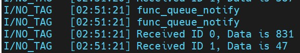

可以看到，在上述代码中共创建了两个线程，并通过队列app_tx_queue进行数据传递。当然这也是基础的应用，实际开发中，往往增加相应的软硬件处理功能。

## 信号量和互斥量

### 信号量（Semaphore）

信号量是一种常用的同步线程的机制。对于Threadx来说，其信号量只支持数值信号量(Counting Semaphore)，并通过不同的put接口来设置是否限制信号量的值。

Threadx支持的信号量接口如下所示。

| 信号量接口 | 描述 |
| --- | --- |
| tx_semaphore_create | 创建信号量 |
| tx_semaphore_delete | 删除信号量 |
| tx_semaphore_get | 获取信号量 |
| tx_semaphore_info_get | 获取信号量信息 |
| tx_semaphore_performance_info_get | 获取信号量性能信息 |
| tx_semaphore_performance_system_info_get | 获取信号量系统性能信息 |
| tx_semaphore_prioritize | 优化信号量阻塞队列(多任务同时获取信号量时，优先级高的任务先获取) |
| tx_semaphore_put | 释放信号量 |
| tx_semaphore_ceiling_put | 带限值的释放信号量 |
| tx_semaphore_put_notify | 设置信号量发送完成的函数 |

对于上述接口，比较常用的如下所示。

```c
// 创建信号量(对应tx_semaphore_create)
// @param semaphore_ptr 信号量指针
// @param name_ptr 信号量名称指针
// @param initial_count 初始信号量值
// @return 执行结果，TX_SUCCESS表示成功，其他值表示失败原因
UINT  _tx_semaphore_create(TX_SEMAPHORE *semaphore_ptr, CHAR *name_ptr, ULONG initial_count)

// 获取信号量(对应tx_semaphore_get)
// @param semaphore_ptr 信号量指针
// @param timeout 等待时间
// @return 执行结果，TX_SUCCESS表示成功，其他值表示失败原因
UINT  _tx_semaphore_get(TX_SEMAPHORE *semaphore_ptr, ULONG timeout)

// 释放信号量(对应tx_semaphore_put)
// @param semaphore_ptr 信号量指针
// @return 执行结果，TX_SUCCESS表示成功，其他值表示失败原因
UINT  _tx_semaphore_put(TX_SEMAPHORE *semaphore_ptr)

// 带限值的释放信号量(对应tx_semaphore_ceiling_put)
// @param semaphore_ptr 信号量指针
// @param ceiling_value 信号量上限值
// @return 执行结果，TX_SUCCESS表示成功，其他值表示失败原因
UINT  _tx_semaphore_ceiling_put(TX_SEMAPHORE *semaphore_ptr, ULONG ceiling_value)

// 设置信号量发送完成的回调函数(对应tx_semaphore_put_notify)
// @param semaphore_ptr 信号量指针
// @param semaphore_put_notify 回调函数指针
// @return 执行结果，TX_SUCCESS表示成功，其他值表示失败原因
UINT  _tx_semaphore_put_notify(TX_SEMAPHORE *semaphore_ptr, 
    VOID (*semaphore_put_notify)(TX_SEMAPHORE *notify_semaphore_ptr))
```

### 互斥量

在ThreadX中，互斥量主要设计用于资源保护，具有如下特点：

- **优先级继承**：高优先级线程等待低优先级线程持有的互斥量时，低优先级线程的优先级会临时升高，防止发生优先级翻转。
- **互斥量嵌套**: 对于单个线程，支持多次获取同一个互斥量，只要在处理完成后释放相同次数即可。

关于互斥量的接口如下所示。

| 互斥量接口 | 描述 |
| --- | --- |
| tx_mutex_create | 创建互斥量 |
| tx_mutex_delete | 删除互斥量 |
| tx_mutex_get | 获取互斥量 |
| tx_mutex_info_get | 获取互斥量信息 |
| tx_mutex_performance_info_get | 获取互斥量性能信息 |
| tx_mutex_performance_system_info_get | 获取互斥量系统性能信息 |
| tx_mutex_prioritize | 优化互斥量阻塞队列(多任务同时获取互斥量时，优先级高的任务先获取) |
| tx_mutex_put | 释放互斥量 |

对于上述接口，比较常用的如下所示。

```c
// 创建互斥量(对应tx_mutex_create)
// @param mutex_ptr 互斥量指针
// @param name_ptr 互斥量名称指针
// @param inherit 是否开启优先级继承功能(TX_TRUE:开启, TX_FALSE:关闭)
// @return 执行结果，TX_SUCCESS表示成功，其他值表示失败原因
UINT  _tx_mutex_create(TX_MUTEX *mutex_ptr, CHAR *name_ptr, UINT inherit)

// 获取互斥量(对应tx_mutex_get)
// @param mutex_ptr 互斥量指针
// @param timeout 等待时间
// @return 执行结果，TX_SUCCESS表示成功，其他值表示失败原因
UINT  _tx_mutex_get(TX_MUTEX *mutex_ptr, ULONG timeout)

// 释放互斥量(对应tx_mutex_put)
// @param mutex_ptr 互斥量指针
// @return 执行结果，TX_SUCCESS表示成功，其他值表示失败原因
UINT  _tx_mutex_put(TX_MUTEX *mutex_ptr)
```

### 信号量和互斥量的应用

对于信号量和互斥量，具体应用如下所示。

```c
#include "app_semap_mutex.h"
#include "elog.h"

#define APP_QUEUE_NUMS          16
#define APP_STACK_SIZE          512
#define APP_THREAD_PRIO         9

static TX_SEMAPHORE app_tx_semaphore = {0};
static TX_MUTEX app_tx_mutex = {0};

static TX_THREAD tx_app_rx_thread = {0};
static TX_THREAD tx_app_tx_thread = {0};

static volatile int g_i = 0;

static void semaphore_rx_thread_entry(ULONG thread_input)
{
    UINT status;
    int index = 0;   

    for (index=0; index<100; index++) {
        tx_mutex_get(&app_tx_mutex, TX_WAIT_FOREVER);
        g_i++;
        tx_mutex_put(&app_tx_mutex);
        
        // 延时等待1ms
        tx_thread_sleep(1);
    }
   
    while(1) {
        status = tx_semaphore_get(&app_tx_semaphore, TX_WAIT_FOREVER);
        if(status == TX_SUCCESS) {
            log_i("semaphore get success, g_i:%d!", g_i);   // 获取信号量
        } else {
            log_i("semaphore get failed!");
        }
    }    
}

static void semaphore_tx_thread_entry(ULONG thread_input)
{    
    int index = 0;
    
    for (index=0; index<100; index++) {
        tx_mutex_get(&app_tx_mutex, TX_WAIT_FOREVER);
        g_i++;
        tx_mutex_put(&app_tx_mutex);
        
        // 延时等待1ms
        tx_thread_sleep(1);
    }

    while(1) {
        tx_semaphore_put(&app_tx_semaphore);
        
        tx_thread_sleep(500);
    }    
}

VOID func_semap_notify(TX_SEMAPHORE *semap)
{
    log_i("func_semap_notify id:0x%x", semap->tx_semaphore_id);
}

GlobalType_t app_semap_mutex_init(VOID *memory_ptr)
{
    CHAR *pointer;
    TX_BYTE_POOL *byte_pool = (TX_BYTE_POOL*)memory_ptr;
    
    // 创建信号量
    if (tx_semaphore_create(&app_tx_semaphore, "tx app semaphore", 0) != TX_SUCCESS) {
        return RT_FAIL;
    }
    
    // 设置信号量发送完成的回调函数
    if (tx_semaphore_put_notify(&app_tx_semaphore, func_semap_notify) != TX_SUCCESS) {
        return RT_FAIL;
    }
    
    // 创建互斥量
    if (tx_mutex_create(&app_tx_mutex, "tx app mutex", TX_NO_INHERIT) != TX_SUCCESS) {
        return RT_FAIL;
    }
    
    // 创建接收线程
    if (tx_byte_allocate(byte_pool, (VOID**) &pointer, APP_STACK_SIZE, TX_NO_WAIT) != TX_SUCCESS) {
        return RT_FAIL;
    }
    
    if (tx_thread_create(&tx_app_rx_thread, "tx_app_rx_thread", 
        semaphore_rx_thread_entry, 0, 
        pointer,
        APP_STACK_SIZE, 
        APP_THREAD_PRIO, 
        APP_THREAD_PRIO,
        TX_NO_TIME_SLICE, 
        TX_AUTO_START) != TX_SUCCESS) {
        return RT_FAIL;
    }
  
    // 创建发送线程
    if (tx_byte_allocate(byte_pool, (VOID**) &pointer, APP_STACK_SIZE, TX_NO_WAIT) != TX_SUCCESS) {
        return RT_FAIL;
    }
    
    // create tx thread
    if (tx_thread_create(&tx_app_tx_thread, "tx_app_tx_thread", 
        semaphore_tx_thread_entry, 0, 
        pointer,
        APP_STACK_SIZE, 
        APP_THREAD_PRIO, 
        APP_THREAD_PRIO,
        TX_NO_TIME_SLICE, 
        TX_AUTO_START) != TX_SUCCESS) {
        return RT_FAIL;
    }    
    return RT_OK;
}
```

关于上述代码，执行结果如下所示。

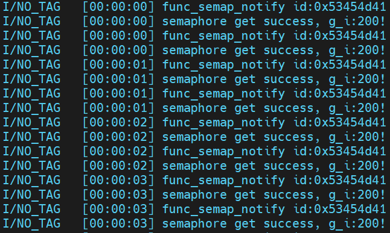

在ThreadX系统中，信号量（Semaphore）与互斥量（Mutex）是实现任务间同步与资源保护的核心机制之一。

信号量主要用于任务间的同步或管理计数资源，它支持从外部（中断服务程序或不同线程）释放，但不具备优先级继承机制。

互斥量则主要用于独占式资源保护，旨在解决临界区的竞争问题。它引入了`优先级继承`来防止优先级反转现象，并且严格遵守`所有权原则`。

信号量和互斥量作为任务间信息交换的机制，是学习掌握ThreadX系统应用开发的重要组成部分，值得去了解和掌握。

## 事件标志组

事件标志组在ThreadX中由32位的变量组成，每个bit都可以单独表示独立的事件，扩展了多个输入同时影响输出时的工作场景。

在ThreadX中，事件标志组具有如下特点。

- **多条件触发**: 事件标志组可以设置多个事件，这些事件支持组合方式触发，包括AND, OR等方式。
- **自动清除**: 事件标志组触发后，可以通过设置Clear标志，将事件标志组中的事件清除，从而为下次触发做准备。

### 事件标志组接口

关于事件标志组的接口，如下所示。

| 事件标志组接口 | 描述 |
| --- | --- |
| tx_event_flags_create | 创建事件标志组 |
| tx_event_flags_delete | 删除事件标志组 |
| tx_event_flags_get | 获取事件标志组 |
| tx_event_flags_info_get | 获取事件标志组信息 |
| tx_event_flags_performance_info_get | 获取事件标志组性能信息 |
| tx_event_flags_performance_system_info_get | 获取事件标志组系统性能信息 |
| tx_event_flags_set | 设置事件标志组 |
| tx_event_flags_set_notify | 设置事件标志组发送完成的回调函数 |

对于上述接口，比较常用的如下所示。

```c
// 创建事件标志组(对应tx_event_flags_create)
// @param group_ptr 事件标志组指针
// @param name_ptr 事件标志组名称指针
// @param event_control_block_size 事件标志组控制块大小
// @return 事件标志组控制块指针，创建成功返回TX_SUCCESS，否则返回错误码
UINT _txe_event_flags_create(TX_EVENT_FLAGS_GROUP *group_ptr, CHAR *name_ptr, UINT event_control_block_size)

// 删除事件标志组(对应tx_event_flags_delete)
// @param group_ptr 事件标志组指针
// @return 事件标志组控制块指针，删除成功返回TX_SUCCESS，否则返回错误码
UINT _txe_event_flags_delete(TX_EVENT_FLAGS_GROUP *group_ptr);

// 获取事件标志组(对应tx_event_flags_get)
// @param group_ptr 事件标志组指针
// @param requested_flags 请求的标志
// @param get_option 获取选项, 可选值为TX_OR, TX_AND, TX_OR_CLEAR、TX_AND_CLEAR
// @param actual_flags_ptr 实际获取到的标志指针
// @param wait_option 等待选项
// @return 事件标志组控制块指针，获取成功返回TX_SUCCESS，否则返回错误码
UINT _txe_event_flags_get(TX_EVENT_FLAGS_GROUP *group_ptr, ULONG requested_flags,
        UINT get_option, ULONG *actual_flags_ptr, ULONG wait_option);

// 获取事件标志组信息(对应tx_event_flags_info_get)
// @param group_ptr 事件标志组指针
// @param flags_to_set 要设置的标志
// @param set_option 设置选项, 可选值为TX_OR, TX_AND, TX_XOR
// @return 事件标志组控制块指针，设置成功返回TX_SUCCESS，否则返回错误码
UINT _txe_event_flags_set(TX_EVENT_FLAGS_GROUP *group_ptr, ULONG flags_to_set,
        UINT set_option);

// 设置事件标志组发送完成的回调函数(对应tx_event_flags_set_notify)
// @param group_ptr 事件标志组指针
// @param events_set_notify 回调函数指针
// @return 事件标志组控制块指针，设置成功返回TX_SUCCESS，否则返回错误码
UINT _txe_event_flags_set_notify(TX_EVENT_FLAGS_GROUP *group_ptr, VOID (*events_set_notify)(TX_EVENT_FLAGS_GROUP *notify_group_ptr));
```

其中关于flags事件标志组的处理，支持以下定义说明。

- TX_OR: 在set时，表示原标志位和新标志位进行或运算作为结果发送；get时，则表示任意位满足触发接收。
- TX_AND: 在set时，表示原标志位和新标志位进行与运算作为结果发送；get时，则表示所有位都满足触发接收。
- TX_OR_CLEAR:仅在get时使用，表示任意位满足后触发，同时将所有位清除。
- TX_AND_CLEAR:仅在get时使用，表示所有位都满足后触发接收，同时将所有位清除。

参考上述说明，事件组在发送时大部分情况下使用TX_OR，表示事件触发成功。对于接收时，则根据情况选择上述事件处理标志位，不过一般使用TX_OR_CLEAR或TX_AND_CLEAR来自动清除标志位来确保下次接收正常。

### 事件标志组应用

对于事件标志组，具体应用如下所示。

```c
#include "app_event_flag.h"
#include "elog.h"

#define APP_STACK_SIZE          512
#define APP_THREAD_PRIO         9

static TX_EVENT_FLAGS_GROUP event_flag = {0};
static TX_THREAD tx_app_set_event_thread = {0};
static TX_THREAD tx_app_get_event_thread = {0};

/* 事件标志定义 */
#define EVENT_FLAG_0            (0x01)
#define EVENT_FLAG_1            (0x02)
#define EVENT_FLAG_2            (0x04)
#define EVENT_FLAG_3            (0x08)

void event_flag_set_thread_entry(ULONG thread_input)
{
    UINT status;
    UINT flag_index = 0;
    
    while(1)
    {
        /* 轮流设置不同的事件标志 */
        switch(flag_index % 4) {
            case 0:
                status = tx_event_flags_set(&event_flag, EVENT_FLAG_0 | EVENT_FLAG_1, TX_OR);
                break;
            case 1:
                status = tx_event_flags_set(&event_flag, EVENT_FLAG_1 | EVENT_FLAG_2, TX_OR);
                break;
            case 2:
                status = tx_event_flags_set(&event_flag, EVENT_FLAG_2, TX_OR);
                break;
            case 3:
                status = tx_event_flags_set(&event_flag, EVENT_FLAG_3, TX_OR);
                break;
        }
        
        flag_index++;
        
        tx_thread_sleep(1000);
    }
}

void event_flag_get_thread_entry(ULONG thread_input)
{
    UINT status;
    ULONG actual_flags;
    
    while(1)
    {
        status = tx_event_flags_get(&event_flag, 
                                   EVENT_FLAG_0 | EVENT_FLAG_1 | EVENT_FLAG_2 | EVENT_FLAG_3, 
                                   TX_OR_CLEAR, 
                                   &actual_flags, 
                                   TX_WAIT_FOREVER);
        
        if(status == TX_SUCCESS) {          
            if(actual_flags & EVENT_FLAG_0) {
                log_i("Event flag 0 received");
            }

            if(actual_flags & EVENT_FLAG_1) {
                log_i("Event flag 1 received");
            }

            if(actual_flags & EVENT_FLAG_2) {
                log_i("Event flag 2 received");
            }

            if(actual_flags & EVENT_FLAG_3) {
                log_i("Event flag 3 received");
            }
        } else {
            log_i("Failed to get event flags, status: %d", status);
        }
    }
}

VOID func_event_notify(TX_EVENT_FLAGS_GROUP *group_ptr)
{
    log_i("func_event_notify id:0x%x", group_ptr->tx_event_flags_group_id);
}

GlobalType_t app_event_flag_init(VOID *memory_ptr)
{
    CHAR *pointer;
    TX_BYTE_POOL *byte_pool = (TX_BYTE_POOL*)memory_ptr;

    // 创建事件标志组
    if (tx_event_flags_create(&event_flag, "app_event_flag") != TX_SUCCESS) {
        return RT_FAIL;
    }
    
    // 设置事件标志组发送完成的回调函数
    if (tx_event_flags_set_notify(&event_flag, func_event_notify) != TX_SUCCESS) {
        return RT_FAIL;
    }

    // 创建设置事件线程
    if (tx_byte_allocate(byte_pool, (VOID **) &pointer, APP_STACK_SIZE, TX_NO_WAIT) != TX_SUCCESS) {
       return RT_FAIL;
    }

    if (tx_thread_create(&tx_app_set_event_thread, 
        "tx_app_set_event_thread", 
        event_flag_set_thread_entry, 0, 
        pointer,
        APP_STACK_SIZE, 
        APP_THREAD_PRIO, 
        APP_THREAD_PRIO,
        TX_NO_TIME_SLICE, 
        TX_AUTO_START) != TX_SUCCESS) 
    {
        return RT_FAIL;
    }
    
    // 创建获取事件线程
    if (tx_byte_allocate(byte_pool, (VOID **) &pointer, APP_STACK_SIZE, TX_NO_WAIT) != TX_SUCCESS) {
       return RT_FAIL;
    }
    
    /* Create get event thread.  */
    if (tx_thread_create(&tx_app_get_event_thread, 
        "tx_app_get_event_thread", 
        event_flag_get_thread_entry, 0, 
        pointer,
        APP_STACK_SIZE, 
        APP_THREAD_PRIO, 
        APP_THREAD_PRIO,
        TX_NO_TIME_SLICE, 
        TX_AUTO_START) != TX_SUCCESS)
    {
        return RT_FAIL;
    }
    
    return RT_OK;
}
```

关于上述代码，执行结果如下所示。

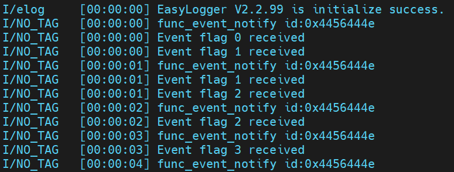

在ThreadX系统中，事件标志组（Event Flags Group）是实现任务间同步的核心机制之一。

事件标志组主要应用在需要多个事件管理同一行为状态的场景，例如自检启动时可能依赖多个硬件的检测结果，此时就可以通过事件标志组进行同步，直到满足所有条件后进行处理。

事件标志组的处理机制，可以天然适配处理多传感器数据聚合（AND）和多源异步触发（OR）的场景，是构建高性能、解耦化RTOS应用的基石。

## 软件定时器(softtimer)

对于单片机来说，定时器主要用于单次或周期性的执行任务或者触发通知。从实现来说，分为硬件定时器和软件定时器类型。

- **硬件定时器**：单片机内部存在的定时器，如系统滴答时钟SysTick，通用和高级定时器Timer等。
- **软件定时器**：软件定时器一般是建立在系统的时钟节拍上，通过事件触发或hook函数，单次或者周期性执行的软件函数。

软件定时器是建立在系统软件实现上，不受硬件数目限制，可以在资源允许的情况下，创建多个软件定时器。不过同样，软件定时器也受限于系统的时钟精度，抖动较大，适用于执行时间较长，对于实时性要求不高的场景。

### 软件定时器说明和接口

在Threadx中，软件定时器的接口如下所示。

| 函数 | 说明 |
| --- | --- |
| tx_time_get | 获取当前系统Tick时钟 |
| tx_time_set | 设置系统Tick时钟 |
| tx_timer_activate | 激活一个软件定时器 |
| tx_timer_deactivate | 停止一个软件定时器 |
| tx_timer_change | 修改一个软件定时器的时间 |
| tx_timer_create | 创建一个软件定时器 |
| tx_timer_delete | 删除一个软件定时器 |
| tx_timer_info_get | 获取一个软件定时器的信息 |
| tx_timer_performance_info_get | 获取软件定时器的性能信息 |
| tx_timer_performance_system_info_get | 获取软件定时器的系统性能信息 |

对于上述接口，比较关键的接口如下所示。

```c
// 获取当前时间(对应函数tx_time_get)
// @return: 当前Tick时钟
ULONG  _tx_time_get(VOID)

// 设置当前时间(对应函数tx_time_set)
// @param new_time: 新的Tick时钟
VOID  _tx_time_set(ULONG new_time)

// 激活定时器(对应函数tx_timer_active)
// @timer_ptr: 处理的定时器
// @return: TX_SUCCESS表示成功，其它表示失败
UINT  _txe_timer_activate(TX_TIMER *timer_ptr)

// 停止定时器(对应函数tx_timer_deactivate)
// @timer_ptr: 处理的定时器
// @return: TX_SUCCESS表示成功，其它表示失败
UINT  _tx_timer_deactivate(TX_TIMER *timer_ptr)

// 创建定时器(对应函数tx_timer_create)
// @timer_ptr: 创建的定时器
// @name_ptr: 定时器的名称
// @expiration_function: 定时器到期时调用的函数
// @expiration_input: 定时器到期时调用的函数的参数
// @initial_ticks: 定时器的初始值
// @reschedule_ticks: 定时器重新启动的间隔
// @auto_activate: 定时器是否自动启动
// @timer_control_block_size: 定时器控制块长度(强制为sizeof(TX_TIMER))
// @return: TX_SUCCESS: 定时器创建成功, 其他: 定时器创建失败
UINT  _txe_timer_create(TX_TIMER *timer_ptr, CHAR *name_ptr,
        VOID (*expiration_function)(ULONG id), ULONG expiration_input,
        ULONG initial_ticks, ULONG reschedule_ticks, UINT auto_activate, UINT timer_control_block_size)

// 删除定时器
// @timer_ptr: 定时器控制块指针
// @return: TX_SUCCESS: 定时器删除成功, 其他: 定时器删除失败
UINT  _txe_timer_delete(TX_TIMER *timer_ptr)
```

对于上述接口，比较常用的就是tx_timer_create，用于创建软件定时器的接口。在此函数的参数接口中，比较重要的如下所示。

- **expiration_input**: expiration_function执行时指定的id值。
- **reschedule_ticks**: 为0表示单次模式，非0表示自动重载模式。
- **initial_ticks**: 定时器的初始值，表示第一
- **auto_activate**: 定时器是否自动启动，支持配置为TX_AUTO_ACTIVATE和TX_NO_ACTIVATE，则创建后定时器立刻启动。

### 软件定时器使用实例

软件定时器的使用实例如下所示。

```c
#include "app_timer.h"
#include "elog.h"

static TX_TIMER one_shot_timer;      /* 一次性定时器 */
static TX_TIMER periodic_timer;      /* 周期性定时器 */
static TX_EVENT_FLAGS_GROUP timer_event_flag = {0};
static TX_THREAD tx_app_timer_get_event_thread = {0};
static volatile ULONG one_shot_count = 0;
static volatile ULONG periodic_count = 0;

#define APP_STACK_SIZE                512
#define APP_THREAD_PRIO               9
#define TIME_EVENT_FLAG_0            (0x01)
#define TIME_EVENT_FLAG_1            (0x02)

// one-shot timer callback
void one_shot_timer_callback(ULONG timer_input)
{
    tx_event_flags_set(&timer_event_flag, TIME_EVENT_FLAG_0, TX_OR);
}

// periodic timer callback
void periodic_timer_callback(ULONG timer_input)
{
    tx_event_flags_set(&timer_event_flag, TIME_EVENT_FLAG_1, TX_OR);
}

void timer_event_flag_get_thread_entry(ULONG thread_input)
{
    UINT status;
    ULONG actual_flags;
    
    while(1)
    {
        status = tx_event_flags_get(&timer_event_flag, 
                                   TIME_EVENT_FLAG_0 | TIME_EVENT_FLAG_1, 
                                   TX_OR_CLEAR, 
                                   &actual_flags, 
                                   TX_WAIT_FOREVER);
        
        if(status == TX_SUCCESS)
        {          
            if(actual_flags & TIME_EVENT_FLAG_0)
            {
                one_shot_count++;
                log_i("One-shot timer triggered! Count: %lu", one_shot_count);
            }

            if(actual_flags & TIME_EVENT_FLAG_1)
            {
                periodic_count++;
                log_i("Periodic timer triggered! Count: %lu", periodic_count);
            }
        }
        else
        {
            log_i("Failed to get event flags, status: %d", status);
        }
    }
}

GlobalType_t app_timer_init(VOID *memory_ptr)
{
    UINT status;
    CHAR *pointer;
    TX_BYTE_POOL *byte_pool = (TX_BYTE_POOL*)memory_ptr;
    
    /* create one-shot timer */
    // @timer_ptr: Timer pointer.
    // @name_ptr: Timer name.
    // @expiration_function: Timer expiration function.
    // @expiration_input: Timer expiration input.
    // @initial_ticks: Timer initial ticks.
    // @reschedule_ticks: Timer reschedule ticks, zero means no reschedule.
    // @auto_activate: Auto activate.
    status = tx_timer_create(&one_shot_timer, "one_shot_timer", 
                        one_shot_timer_callback, 0, 
                        5000, 0, TX_AUTO_ACTIVATE);
    if (status != TX_SUCCESS)
    {
        return RT_FAIL;
    }
    
    /* create periodic timer */
    status = tx_timer_create(&periodic_timer, "periodic_timer", 
                            periodic_timer_callback, 0, 
                            2000, 2000, TX_AUTO_ACTIVATE);
    if (status != TX_SUCCESS)
    {
        return RT_FAIL;
    }
    
    if (tx_event_flags_create(&timer_event_flag, "timer_event_flag") != TX_SUCCESS) {
        return RT_FAIL;
    }
    
    /* Allocate the stack for get event thread.  */
    if (tx_byte_allocate(byte_pool, (VOID **) &pointer, APP_STACK_SIZE, TX_NO_WAIT) != TX_SUCCESS)
    {
       return RT_FAIL;
    }
    
    /* Create get event thread.  */
    if (tx_thread_create(&tx_app_timer_get_event_thread, 
        "tx_app_timer_get_event_thread", 
        timer_event_flag_get_thread_entry, 0, 
        pointer,
        APP_STACK_SIZE, 
        APP_THREAD_PRIO, 
        APP_THREAD_PRIO,
        TX_NO_TIME_SLICE, 
        TX_AUTO_START) != TX_SUCCESS)
    {
        return RT_FAIL;
    }
    return RT_OK;
}
```

对于上述代码，执行结果如下所示。

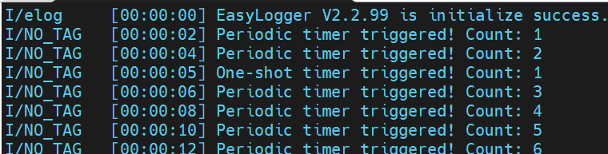

### 软件定时器总结说明

ThreadX的软件定时器是由系统内核提供的，允许开发者在指定的时钟节拍执行指定任务的机制。

对于软件定时器，使用时需要注意以下几点。

- `避免阻塞`：对于Threadx来说，软件定时器共用一个系统线程，堵塞会导致所有定时任务挂起，影响执行时间。
- `快速返回`：软件定时器的处理要尽可能简单，可以是触发单个事件，或者执行单个处理，从而避免阻塞其他定时器的执行。

注意: ThreadX的软件定时器通过宏`TX_TIMER_PROCESS_IN_ISR`定义是否在中断中执行，定义时拥有更高的时间精度，不过同样要符合所有在中断中执行的要求。默认则由软件定时器线程进行处理，此时需要设置如下宏来设置定时器线程信息。

- `TX_TIMER_THREAD_STACK_SIZE`: 定时器线程栈大小。
- `TX_TIMER_THREAD_PRIO`: 定时器线程优先级。

基于这些特点，软件定时器可以满足通讯超时检测、低频数据处理(如读取传感器数据)等场景的需求，在实践中可以按需使用。

## 系统性能监控

对于ThreadX系统来说，每个模块都提供了监控模块性能的接口。常见的有线程的状态、工作情况、栈使用情况、运行时间等，定时器的名称、状态等。

系统监控同样是ThreadX的重要功能之一，可以在运行过程中分析内存占用、运行效率等信息，优化系统优先级、堆栈占用。也可以在系统执行异常时，作为可收集的数据，帮助定位问题。

了解系统性能监控的接口，也是快速高效应用ThreadX的利器。

### 性能监控接口

对于ThreadX系统，基本每个模块都提供了获取性能信息的接口，这个在之前每个章节的接口中也都有提及，这里专门进行整理，具体如下所示。

| 接口 | 功能 |
| --- | --- |
| thread模块 | |
| `tx_thread_info_get` | 获取单个进程的基本信息，如优先级、状态、运行时间等 |
| `tx_thread_performance_info_get` | 获取单个线程的性能数据，如被抢占次数、恢复的次数等 |
| `tx_thread_performance_system_info_get` | 获取系统线程的性能数据总和 |
| timer模块 | |
| `tx_timer_info_get` | 获取单个定时器的基本信息，如名称、状态、运行次数等。 |
| `tx_timer_performance_info_get` | 获取单个定时器的性能数据，如激活次数、到期次数等 |
| `tx_timer_performance_system_info_get` | 获取系统定时器的性能数据总和 |
| semaphore模块 | |
| `tx_semaphore_info_get` | 获取单个信号量的基本信息，如名称、当前计数值等 |
| `tx_semaphore_performance_info_get` | 获取单个信号量的性能数据，如挂起/释放/超时次数等 |
| `tx_semaphore_performance_system_info_get` | 获取系统信号量的性能数据总和 |
| mutex模块 | |
| `tx_mutex_info_get` | 获取单个互斥量的基本信息，如名称、当前所有者、所有权计数等 |
| `tx_mutex_performance_info_get` | 获取单个互斥量的性能数据，如挂起/释放/超时次数等 |
| `tx_mutex_performance_system_info_get` | 获取系统互斥量的性能数据总和 |
| queue模块 | |
| `tx_queue_info_get` | 获取单个队列的基本信息，如名称、状态、等待队列长度等 |
| `tx_queue_performance_info_get` | 获取单个队列的性能数据，如发送次数、接收次数等 |
| `tx_queue_performance_system_info_get` | 获取系统队列的性能数据总和 |
| event_flag模块 | |
| `tx_event_flag_info_get` | 获取单个事件标志组的基本信息，如名称、事件标志位、挂起线程数等 |
| `tx_event_flag_performance_info_get` | 获取单个事件标志组的性能数据，如发送次数、接收次数等 |
| `tx_event_flag_performance_system_info_get` | 获取系统整体事件标志组的性能数据 |

对于上述表格，大致可以归类于如下信息。

- **tx_xx_info_get**: 获取单个模块在创建和运行过程的实时的状态信息，这些信息大部分在创建后固定，少部分在运行过程中变化。
- **tx_xx_performance_info_get**: 获取单个模块在运行过程中统计的性能数据，一般都是动态变化的信息，随着系统的运行实时更新。
- **tx_xx_performance_system_info_get**: 获取系统整体模块的性能数据，会统计相应模块的全部数据信息，在需要综合处理的时候使用。

对于上述表格中的接口，可以以thread和timer模块为例进行说明，具体如下所示。

```c
// 获取线程基本信息(tx_thread_info_get)
// @thread_ptr: 线程指针，传递处理
// @name: 线程名称，赋值指针
// @state: 线程状态
// @run_count: 运行的CPU ticks数目
// @priority: 线程优先级
// @preemption_threshold: 抢占阈值
// @time_slice: 时间片大小
// @next_thread: 下一个线程指针
// @next_suspended_thread: 下一个被挂起的线程指针
// @return: 返回状态，成功返回TX_SUCCESS，失败返回错误码
UINT  _tx_thread_info_get(TX_THREAD *thread_ptr, CHAR **name, UINT *state, ULONG *run_count,
                UINT *priority, UINT *preemption_threshold, ULONG *time_slice,
                TX_THREAD **next_thread, TX_THREAD **next_suspended_thread)

// 获取定时器性能数据(tx_timer_performance_info_get)
// @timer_ptr: 定时器指针，传递处理
// @activates: 激活次数
// @reactivates: 重新激活次数
// @deactivates: 停用次数
// @expirations: 到期次数
// @expiration_adjusts: 到期调整次数
UINT  _tx_timer_performance_info_get(TX_TIMER *timer_ptr, ULONG *activates, ULONG *reactivates,
                    ULONG *deactivates, ULONG *expirations, ULONG *expiration_adjusts)

// 获取定时器基本信息(tx_timer_info_get)
// @timer_ptr: 定时器指针，传递处理
// @name: 定时器名称，赋值指针
// @active: 定时器是否激活
// @remaining_ticks: 剩余的CPU ticks数目
// @reschedule_ticks: 重新调度的CPU ticks数目
// @next_timer: 下一个定时器指针
// @return: 返回状态，成功返回TX_SUCCESS，失败返回错误码
UINT  _tx_timer_info_get(TX_TIMER *timer_ptr, CHAR **name, UINT *active, ULONG *remaining_ticks,
                ULONG *reschedule_ticks, TX_TIMER **next_timer)

// 获取线程性能数据(tx_thread_performance_info_get)
// @thread_ptr: 线程指针，传递处理
// @resumptions: 恢复次数
// @suspensions: 挂起次数
// @solicited_preemptions: 抢占次数
// @interrupt_preemptions: 中断抢占次数
// @priority_inversions: 优先级反转次数
// @time_slices: 时间片次数
// @relinquishes: 放弃CPU次数
// @timeouts: 超时次数
// @wait_aborts: 等待中断次数
// @last_preempted_by: 最后被抢占的线程指针
// @return: 返回状态，成功返回TX_SUCCESS，失败返回错误码
UINT  _tx_thread_performance_info_get(TX_THREAD *thread_ptr, ULONG *resumptions, ULONG *suspensions,
                ULONG *solicited_preemptions, ULONG *interrupt_preemptions, ULONG *priority_inversions,
                ULONG *time_slices, ULONG *relinquishes, ULONG *timeouts, ULONG *wait_aborts, TX_THREAD **last_preempted_by)
```

需要注意的是，对于**tx_xx_info_get**接口是系统默认支持的功能，而使用performance接口，则需要通过宏定义开启相应的功能。

这里列出在`tx_user.h`文件中需要添加开启的宏，具体如下所示。

```c
// 开启线程性能数据获取
#define TX_THREAD_ENABLE_PERFORMANCE_INFO

// 开启定时器性能数据获取
#define TX_TIMER_ENABLE_PERFORMANCE_INFO

// 开启队列性能数据获取
#define TX_QUEUE_ENABLE_PERFORMANCE_INFO

// 开启信号量性能数据获取
#define TX_SEMAPHORE_ENABLE_PERFORMANCE_INFO

// 开启互斥量性能数据获取
#define TX_MUTEX_ENABLE_PERFORMANCE_INFO

// 开启事件标志组性能数据获取
#define TX_EVENT_FLAGS_ENABLE_PERFORMANCE_INFO
```

另外在ThreadX中，是通过链表来管理线程和定时器的，由如下全局变量进行管理，具体如下所示。

| 全局变量 | 功能 |
| --- | --- |
| `_tx_thread_created_ptr` | 创建的线程链表头指针 |
| `_tx_thread_created_count` | 创建的线程数量 |
| `_tx_timer_created_ptr` | 创建的定时器链表头指针 |
| `_tx_timer_created_count` | 创建的定时器数量 |

在获取定时器的基本信息时，需要遍历定时器链表，需要依赖上述变量进行完整的遍历。

### 线程性能监控应用

基于上述提到的线程、定时器获取数据接口，可以实现线程和定时器的名称、优先级、运行状态和运行时间等信息的输出功能，具体实现如下所示。

```c
#include "app_performance.h"

// global information
extern TX_THREAD * _tx_thread_created_ptr;
extern TX_TIMER  * _tx_timer_created_ptr;
extern ULONG     _tx_thread_created_count;
extern ULONG     _tx_timer_created_count;

// internal information
static TX_THREAD performance_task;
static TX_TIMER performance_timer;
static TX_SEMAPHORE app_performance_semaphore = {0};

static ThreadPerformance_t thread_perf[MAX_THREAD_NUM];
static ULONG thread_count = 0;
static TimerPerformance_t timer_perf[MAX_THREAD_NUM];
static ULONG timer_count = 0;
static ULONG total_system_time = 0;
static ULONG last_total_time = 0;

// 获取线程状态转换字符串
static const CHAR* get_thread_state(UINT state)
{
    switch(state) {
        case TX_READY:
            return "READY";
        case TX_COMPLETED:
            return "COMPLETED";
        case TX_TERMINATED:
            return "TERMINATED";
        case TX_SUSPENDED:
            return "SUSPENDED";
        case TX_SLEEP:
            return "SLEEP";
        case TX_QUEUE_SUSP:
            return "WAIT_QUEUE";
        case TX_SEMAPHORE_SUSP:
            return "WAIT_SEM";
        case TX_EVENT_FLAG:
            return "WAIT_EVENT";
        case TX_BLOCK_MEMORY:
            return "WAIT_BLOCK_MEM";
        case TX_BYTE_MEMORY:
            return "WAIT_BYTE_MEM";
        case TX_IO_DRIVER:
            return "WAIT_IO";
        case TX_FILE:
            return "WAIT_FILE";
        case TX_TCP_IP:
            return "WAIT_TCPIP";
        case TX_MUTEX_SUSP:
            return "WAIT_MUTEX";
        case TX_PRIORITY_CHANGE:
            return "PRIORITY_CHG";
        default:
            return "UNKNOWN";
    }
}

static void get_thread_performance(void)
{
    TX_THREAD *thread_ptr;
    ULONG index = 0;
    UINT preempt_threshold;
    ULONG time_slice;
    TX_THREAD *next_thread;
    TX_THREAD *next_suspended_thread;
    
    thread_count = 0;
    
    // 遍历所有线程, 获取线程信息
    thread_ptr = _tx_thread_created_ptr;
    while(index < _tx_thread_created_count) {
        tx_thread_info_get(thread_ptr, &thread_perf[index].thread_name, &thread_perf[index].state,
                        &thread_perf[index].run_time, &thread_perf[index].priority, &preempt_threshold,
                        &time_slice, &next_thread, &next_suspended_thread);        
        
        thread_perf[index].thread_ptr = thread_ptr;
        
        thread_perf[index].stack_size = thread_ptr->tx_thread_stack_size;
        thread_perf[index].stack_used = (ULONG)((CHAR*)thread_ptr->tx_thread_stack_ptr -
                                              (CHAR*)thread_ptr->tx_thread_stack_start + 1);
        
        index++;
        thread_ptr = thread_ptr->tx_thread_created_next;
    }
    
    thread_count = index;
}

/* 获取定时器性能信息 */
static void get_timer_performance(void)
{
    TX_TIMER *timer_ptr;
    ULONG index = 0;
    
    timer_count = 0;
    
    // 遍历所有定时器, 获取定时器信息
    timer_ptr = _tx_timer_created_ptr;
    while(index < _tx_timer_created_count) {
        tx_timer_info_get(timer_ptr, &timer_perf[index].timer_name, &timer_perf[index].active,
                        &timer_perf[index].expiration_count, TX_NULL, TX_NULL);
        
        timer_perf[index].timer_ptr = timer_ptr;
        
        index++;
        timer_ptr = timer_ptr->tx_timer_created_next;
    }
    
    timer_count = index;
}

/* 输出性能报告 */
void performance_report(void)
{
    ULONG i;
    ULONG delta_time;
    ULONG cpu_usage;
    
    total_system_time = tx_time_get();
    delta_time = total_system_time - last_total_time;
    
    if(delta_time == 0)
        delta_time = 1;
    
    printf("\r\n========================================\r\n");
    printf("     ThreadX Performance Report\r\n");
    printf("========================================\r\n");
    printf("System Time: %lu ticks\r\n", total_system_time);
    printf("Report Interval: %lu ticks\r\n", delta_time);
    printf("========================================\r\n");
    
    printf("\r\n--- Thread Performance ---\r\n");
    printf("%2s %-20s %4s %-12s %6s %6s %6s\r\n",
           "No", "Name", "Prio", "State", "Stack", "Used", "CPU%%");
    printf("-------------------------------------------------------------------\r\n");
    
    // 输出线程信息
    for(i = 0; i < thread_count; i++) {
        cpu_usage = ((thread_perf[i].run_time - thread_perf[i].last_run_time) * 100) / delta_time;
        
        printf("%2lu %-20s %4u %-12s %6lu %6lu %6lu%%\r\n",
               i,
               thread_perf[i].thread_name,
               thread_perf[i].priority,
               get_thread_state(thread_perf[i].state),
               thread_perf[i].stack_size,
               thread_perf[i].stack_used,
               cpu_usage);
        
        thread_perf[i].last_run_time = thread_perf[i].run_time;
    }
    
    // 输出定时器信息
    printf("\r\n--- Timer Performance ---\r\n");
    printf("%2s %-20s %6s %12s\r\n",
           "No", "Name", "Active", "Expirations");
    printf("--------------------------------------------\r\n");
    
    for(i = 0; i < timer_count; i++) {
        ULONG delta_exp = timer_perf[i].expiration_count - timer_perf[i].last_expiration;
        
        printf("%2lu %-20s %6s %12lu (+%lu)\r\n",
               i,
               timer_perf[i].timer_name,
               timer_perf[i].active ? "Yes" : "No",
               timer_perf[i].expiration_count,
               delta_exp);
        
        // 更新上次到期
        timer_perf[i].last_expiration = timer_perf[i].expiration_count;
    }
    
    printf("\r\n========================================\r\n\r\n");

    
    last_total_time = total_system_time;
}

/* 性能检测任务入口函数 */
static void performance_task_entry(ULONG thread_input)
{
    UINT status;
    
    last_total_time = tx_time_get();

    get_thread_performance();
    for(ULONG i = 0; i < thread_count; i++) {
        thread_perf[i].last_run_time = thread_perf[i].run_time;
    }
    
    get_timer_performance();
    for(ULONG i = 0; i < timer_count; i++) {
        timer_perf[i].last_expiration = timer_perf[i].expiration_count;
    }
    
    while(1)
    {
        status = tx_semaphore_get(&app_performance_semaphore, TX_WAIT_FOREVER);
        if (status == TX_SUCCESS) {
            get_thread_performance();
            
            get_timer_performance();
            
            performance_report();
        } else {
            printf("tx semaphore get failed: %d\r\n", status);
        }
    }
}

void performance_timer_timer_callback(ULONG timer_input)
{
    tx_semaphore_put(&app_performance_semaphore);
}

GlobalType_t app_performance_init(VOID *memory_ptr)
{
    CHAR *pointer;
    TX_BYTE_POOL *byte_pool = (TX_BYTE_POOL*)memory_ptr;
    
    if(tx_byte_allocate(byte_pool, (VOID**)&pointer, PERFORMANCE_TASK_STACK_SIZE, TX_NO_WAIT) != TX_SUCCESS)
    {
        printf("Failed to allocate memory for performance task stack\r\n");
        return RT_FAIL;
    }
    
    if(tx_thread_create(&performance_task, "performance_task", performance_task_entry, 0,
                        pointer, PERFORMANCE_TASK_STACK_SIZE, PERFORMANCE_TASK_PRIO, PERFORMANCE_TASK_PRIO,
                        TX_NO_TIME_SLICE, TX_AUTO_START) != TX_SUCCESS)
    {
        printf("Failed to create performance task\r\n");
        return RT_FAIL;
    }
    
    if (tx_semaphore_create(&app_performance_semaphore, "app_performance_semaphore", 0) != TX_SUCCESS) {
        return RT_FAIL;
    }
    
    /* create periodic timer */
    if(tx_timer_create(&performance_timer, "performance_timer", performance_timer_timer_callback, 
                        0, 2000, 2000, TX_AUTO_ACTIVATE) != TX_SUCCESS)
    {
        return RT_FAIL;
    }
    
    printf("Performance monitoring initialized successfully\r\n");
    return RT_OK;
}
```

对于上述代码，执行结果如下所示。

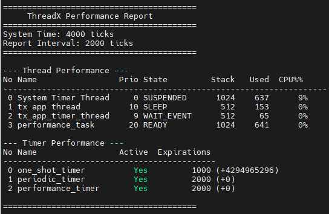

可以看到，通过上述代码，实现了类似Linux的top命令功能，输出任务的运行状态，以及任务运行时间占比、堆栈使用量等信息。

ThreadX的系统监控，是RTOS本身提供的用于监控和优化应用的手段。通过这些信息，可以基于堆栈的剩余量，判断初始时堆栈大小是否合理，并进行调整；也可以根据实际运行状态，调整任务优先级来适配功能需求，从而最优化的使用ThreadX进行开发，具有重要的实用价值。

## 返回目录

[返回目录](./../README.md)
