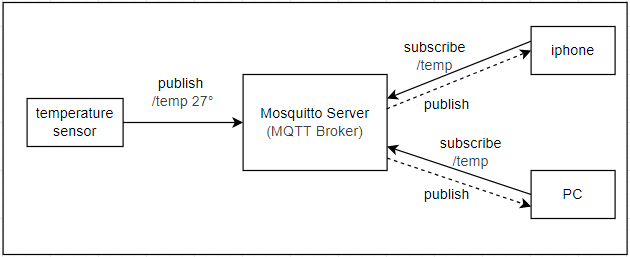
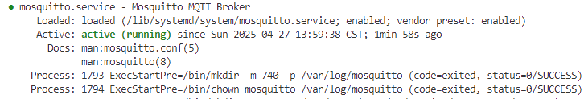
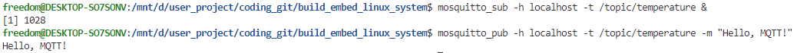
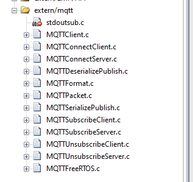

# MQTT协议解析和应用

MQTT全称（Message Queuing Telemetry Transport）是一种轻量级、基于发布-订阅模式的消息传输协议；适用于资源受限的设备和低带宽、高延迟或不稳定的网络环境。

MQTT协议常用于物联网、工业自动化、车联网和能源管理等领域，具有以下特点:

💡 **轻量级**：报文格式简单，头部开销小，这使得它在资源受限的设备上也能轻松运行，减少了设备的处理负担和网络带宽的占用  
💡 **发布-订阅模式**：支持发布-订阅模式，即多个客户端可以订阅同一个主题，当有消息发布到该主题时，所有订阅该主题的客户端都会收到该消息。解耦了消息的发送者和接收者，提高了灵活性  
💡 **Qos支持**：支持三种 QoS（Quality of Service）级别，分别是 0、1 和 2，用于确保消息的可靠传输  
💡 **保持活动机制**： 支持保持活动机制，即当客户端断开连接后，服务器会保留该客户端的订阅关系和消息，当客户端重新连接时，服务器会将该客户端的订阅关系和消息重新发送给该客户端  
💡 **支持多种传输协议**：支持多种传输协议，如TCP/IP、WebSocket等，使得MQTT协议在多种网络环境中都能很好的运行  

本文以应用为主干，结合MQTT协议的特点，内容目录如下所示。

📑 **MQTT工作原理**
📑 **MQTT-Broker服务器**
📑 **MQTT-Client应用开发**
📑 **总结和经验说明**  

## MQTT工作原理

MQTT是基于发布-订阅模式的通信协议，由MQTT客户端通过主题（Topic）发布或订阅消息，通过MQTT-Broker集中管理消息路由；并依据预设的服务质量等级(QoS)确保端到端消息传递可靠性。其中各部分说明如下。

🧩 **MQTT客户端**

任何运行MQTT客户端库的应用或设备都是MQTT客户端。例如，使用MQTT的即时通讯应用是客户端，使用MQTT上报数据的各种传感器是客户端，各种MQTT测试工具也是客户端。

🧩 **MQTT-Broker服务端**

负责处理客户端请求的关键组件；包括建立连接、断开连接、订阅和取消订阅等操作，同时还负责消息的转发。

一个高效强大的MQTT-Broker能够轻松应对海量连接和百万级消息吞吐量，从而帮助物联网服务提供商专注于业务发展，快速构建可靠的MQTT应用。对于开发来说，可以自己搭建，也可以使用现成的服务。

常见的Broker方案如下所示。

💡 EMQX：EMQX是一个开源的、高性能的MQTT-Broker，支持多种协议，如MQTT、MQTT-SN、CoAP等  
💡 Mosquitto：Mosquitto是一个轻量级的开源MQTT-Broker，支持多种协议，如MQTT、MQTT-SN、CoAP等  
💡  HiveMQ：HiveMQ是一个功能强大的MQTT-Broker，支持多种协议，如MQTT、MQTT-SN、CoAP等  
💡 OPEN MQ: OPEN MQ是一个开源的、高性能的MQTT-Broker，支持多种协议，如MQTT、MQTT-SN、CoAP等  

🧩 MQTT主题（Topic）

MQTT协议中的一个重要概念，用于标识消息的目的地。客户端可以订阅一个或多个主题，当有消息发布到这些主题时，所有订阅该主题的客户端都会收到该消息。主题通常由多个层级组成，用“/”分隔，例如“/topic/temp”表示温度主题。

Qos:  提供了三种服务质量（QoS），在不同网络环境下保证消息的可靠性。

💡 QoS 0：消息最多传送一次。如果当前客户端不可用，它将丢失这条消息  
💡 QoS 1：消息至少传送一次  
💡 QoS 2：消息只传送一次  

另一个关键信息就发布-订阅模式，它解耦了消息的发送者（发布者）和接收者（订阅者）；发布者和订阅者之间无需建立直接连接，而是通过MQTT-Broker来负责消息的路由和分发；这里展示基于Mosquitto的MQTT的通讯框架典型应用实现。



由上图可知，MQTT的工作流程如下所示。

1. 客户端使用MQTT框架与MQTT-Broker建立连接，可以选择使用TLS/SSL加密来实现安全通信。客户端提供认证信息，并指定会话类型（Clean Session 或 Persistent Session）。
2. 客户端既可以向特定主题发布消息，也可以订阅主题以接收消息。当客户端发布消息时，它会将消息发送给 MQTT-Broker；而当客户端订阅消息时，它会接收与订阅主题相关的消息。
3. MQTT-Broker接收发布的消息，并将这些消息转发给订阅了对应主题的客户端。它根据 QoS 等级确保消息可靠传递，并根据会话类型为断开连接的客户端存储消息。

下面开始从应用角度来介绍MQTT的实现。

## MQTT-Broker服务器

对于mqtt的应用，第一步是搭建自己服务，这里使用mosquitto，在ubuntu系统下安装mosquitto，命令如下所示。

```shell
# 安装mosquitto服务器
sudo apt-get install mosquitto mosquitto-clients
```

安装完成后，启动mosquitto，命令如下所示。

```shell
# 启动mosquitto服务器
sudo systemctl start mosquitto
```

启动完成后，查看mosquitto的状态，命令如下所示。

```shell
# 查看mosquitto服务器状态
systemctl status mosquitto
```



由上图可知，mosquitto服务器已经启动成功。

此时可以通过如下命令测试mosquitto服务器是否正常。

```shell
# 订阅本地地址(127.0.0.1:1883)上的/topic/temperature主题
mosquitto_sub -h localhost -t /topic/temperature &

# 发布消息
mosquitto_pub -h localhost -t /topic/temperature -m "Hello, MQTT!"
```



由上图可知，mosquitto服务器已经正常运行，已经能够正常的订阅和发布消息。

## MQTT-Client应用开发

对于单片机来说，本项目主要使用paho.mqtt来支持MQTT-client应用。

paho.mqtt的下载地址：<https://github.com/eclipse-paho/paho.mqtt.c>

在实现MQTT-Client前，需要完整支持TCP/IP服务，这一步骤可参考文档如下。

- [ETH模块和LWIP网络应用](./ch02-05.eth_lwip.md)

在此基础上，即可引入MQTT-Client应用，其中添加到系统中文件如下所示。



其中软件实现中的有两个文件：

💡 **MQTTFreeRTOS.c**：用于提供MQTT任务创建和运行时的窗口
💡 **mqtt_app.c**：应用实践的接口

具体实现如下所示。

```c
// mqtt_app.c文件
// mqtt应用接口
void messageArrived(MessageData* md)
{
    MQTTMessage* message = md->message;
    char *pbuf = (char *)pvPortMalloc(message->payloadlen+1);

    memcpy(pbuf, message->payload, message->payloadlen);
    pbuf[message->payloadlen] = '\0';

    PRINT_LOG(LOG_INFO, xTaskGetTickCount(), "len:%d data:%s", (int)message->payloadlen, (char*)pbuf);

    MQTTPublish(&c, "/info/pub", message);
    vPortFree(pbuf);
}

// 用于mqtt客户端的应用
void mqtt_client_task(void *argument)
{
    int rc = 0;

    while(1)
    {
        //only check link up
        if(!netif_link_up())
        {
            vTaskDelay(1000);
            continue;
        }
        
        NetworkInit(&n);
        
        // 连接网络设备
        rc = NetworkConnect(&n, opts.host, opts.port);
        if (rc)
        {  
            PRINT_LOG(LOG_ERROR, xTaskGetTickCount(), "mqtt connecting to %s:%d failed!", opts.host, opts.port);
            NetworkDisconnect(&n);
            vTaskDelay(1000);
            continue; 
        }
        
        // 连接mqtt服务器
        MQTTClientInit(&c, &n, 1000, buf, 1000, readbuf, 1000);
        MQTTPacket_connectData data = MQTTPacket_connectData_initializer;       
        data.willFlag = 0;
        data.MQTTVersion = 3;
        data.clientID.cstring = opts.clientid;
        data.username.cstring = opts.username;
        data.password.cstring = opts.password;

        data.keepAliveInterval = 10000;
        data.cleansession = 1;
        
        rc = MQTTConnect(&c, &data);
        if (rc) {
            PRINT_LOG(LOG_INFO, xTaskGetTickCount(), "mqtt connected to %d, topic:%s failed", rc, opts.sub_topic);
            goto exit;
        }    
        rc = MQTTSubscribe(&c, opts.sub_topic, opts.qos, messageArrived);
        if (rc) {
            goto exit;
        }

        PRINT_LOG(LOG_INFO, xTaskGetTickCount(), "mqtt connected to %d success, topic:%s", rc, opts.sub_topic);
        
        while (!toStop)
        {
            // 周期性MQTT管理应用
            if(MQTTYield(&c, 1000) != MQTT_SUCCESS)
            {
                break;
            }
        }

exit:
        PRINT_LOG(LOG_INFO, xTaskGetTickCount(), "mqtt stop connect!", rc);
        MQTTDisconnect(&c);
        NetworkDisconnect(&n);
    }
}

// 创建mqtt应用
GlobalType_t mqtt_app_init(void)
{   
    mqttHandle = osThreadNew(mqtt_client_task, NULL, &mqttTask_attributes);
    if(mqttHandle == NULL)
    {
        return RT_FAIL;
    }
  
    return RT_OK;
}
```

对于FreeRTOS应用接口，主要接口如下所示。

```c
// mqtt_app.c文件
void NetworkInit(Network* n)
{
    n->my_socket = 0;
    n->mqttread = FreeRTOS_read;
    n->mqttwrite = FreeRTOS_write;
    n->disconnect = FreeRTOS_disconnect;
}

// 用于接收网络数据的接口 
int FreeRTOS_read(Network* n, unsigned char* buffer, int len, int timeout_ms)
{
    TickType_t xTicksToWait = timeout_ms / portTICK_PERIOD_MS; /* convert milliseconds to ticks */
    int recvLen = 0;

    do
    {
        int rc = 0;

        setsockopt(n->my_socket, 0, SO_RCVTIMEO, &xTicksToWait, sizeof(xTicksToWait));
        rc = recv(n->my_socket, buffer + recvLen, len - recvLen, 0);
        if (rc > 0)
            recvLen += rc;
        else
        {
            recvLen = rc;
            break;
        }
    } while (recvLen < len);

    return recvLen;
}

// 用于发送网络数据的接口 
int FreeRTOS_write(Network* n, unsigned char* buffer, int len, int timeout_ms)
{
    TickType_t xTicksToWait = timeout_ms / portTICK_PERIOD_MS; /* convert milliseconds to ticks */
    int sentLen = 0;

    do
    {
        int rc = 0;

        setsockopt(n->my_socket, 0, SO_SNDTIMEO, &xTicksToWait, sizeof(xTicksToWait));
        rc = send(n->my_socket, buffer + sentLen, len - sentLen, 0);
        if (rc > 0)
            sentLen += rc;
        else
        {
            sentLen = rc;
            break;
        }
    } while (sentLen < len);

    return sentLen;
}
```

## summary

至此，关于MQTT相关内容初步介绍完毕。本文围绕MQTT展开，介绍其概念、特点、工作机制；并基于开源的协议和工具，描述构建和使用MQTT-Broker和MQTT-Client的方法。

MQTT应用上通过解耦，将传统的CS框架(客户端-服务器模式)，改为客户端-代理Broker-客户端的模式；这样单个节点的断开对于整个系统的影响就会很小，同时降低了实现一对多、多对多通讯的系统框架；通过MQTT-Broker承接了关键的连接，消息分发功能，降低了边缘智能设备的负载，同时通过QOS一定程度上确保了了消息传递的可靠性，使得边缘智能设备可以更加专注于业务逻辑的开发；如果希望了解智能家居，边缘计算，对于MQTT协议的理解，将是重要的环节。

本文只能算是应用方面的介绍，更多关于MQTT的细节，请参考MQTT官网，并结合应用去实践。

- [MQTT官网](https://mqtt.org/)

## 返回目录

[返回目录](./../README.md)
