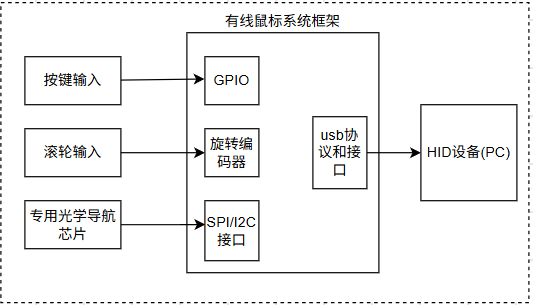
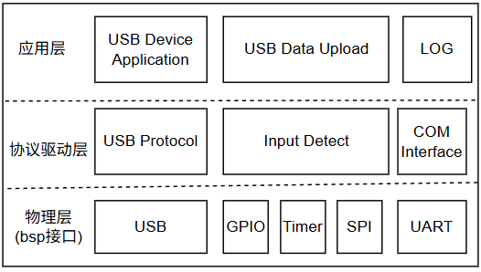

# 有线鼠标设计方案

产品类型：有线鼠标

## 需求分析

有线鼠标一般为USB线缆通讯+供电

有线鼠标设计简单，差异化只能在人体工学、成本控制、响应速率，其它多辅助按键和灯光都属于辅助部分，无太多额外设计。

## 产品框架设计

基础有线鼠标主要支持移动检测、左键/右键按下和释放、滚轮滚动并通过USB作为HID连接PC设备。

整个设备设计框架如下。

其中输入部分包含：

💡 按键输入：普通按键输入、支持防抖设计  
💡 滚轮输入：通过旋转编码器检测旋转增量和方向，作为鼠标输入  
💡 专用光学导航芯片：通过带红外和摄像头的专用光学导航芯片，直接读取位移并处理  

输出部分是基于USB的HID设备，作为鼠标HID类型输入。

## 硬件模块和软件模块设计

硬件模块主要包含：主控选型、按键设计(微动开关)、旋转编码器(连接普通I/O或Timer编码器检测引脚)、基于SPI接口的光学导航芯片、USB供电和通讯接口

软件模块设计:

其中USB协议部分选择使用tinyusb实现。

功能上分为三部分组成:

💡 基于tinyusb的HID设备实现，包含底层驱动、描述符和上报接口实现  
💡 外部输入检测，包含按键点击/移除检测、编码器方向和增量检测、光学导航芯片位置检测(返回的增量X/Y)  
💡 HID数据上传，将检测到的变化转换为事件进行处理，并通过USB端点进行上传通知  
